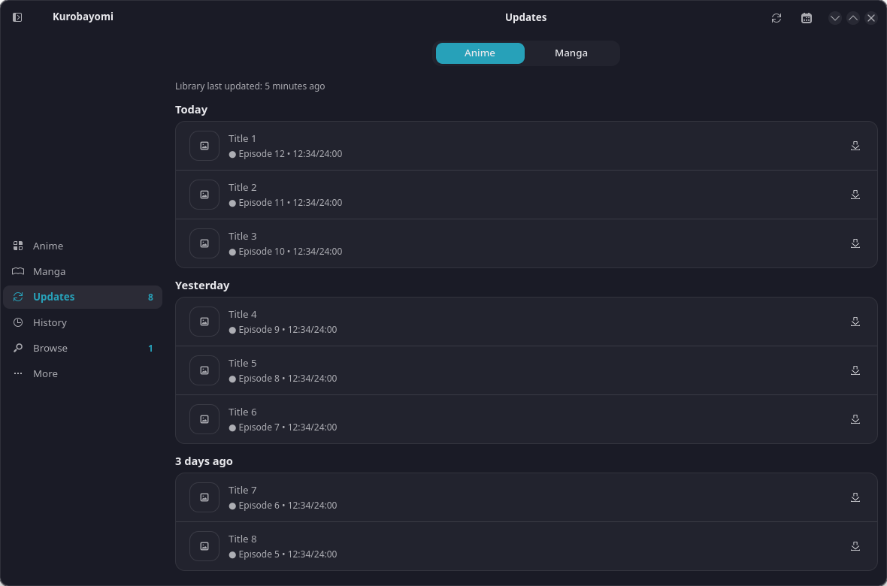

# Kurobayomi

A manga reader and anime player for the Linux desktop, written in Rust with GTK4 (no libadwaita, so your own GTK theme applies).
It is a rewrite of [Aniyomi](https://github.com/aniyomiorg/aniyomi): same library, reader, player, sources and tracking model, built as a native app instead of an Android one.

The name is *kurobako* (黒箱, "black box") plus *-yomi* ("reading"), like Tachiyomi and Aniyomi.



## Status: early work in progress

The window you see is a **mockup with placeholder data**. The real features are being built underneath it, crate by crate.
The plan has about 3,800 tasks. Treat everything as unfinished.

What exists today (library crates with tests, not yet wired to the screens):
- preference store, databases (manga and anime SQLite schemas), repositories and domain rules
- source API and an HTTP source layer, extension manager, local source
- image pipeline and cover handling, archive (CBZ) reading
- download queue, mpv-based player core
- 67 mockup screens, sheets and dialogs that match Aniyomi's layout

What does not work yet: reading and playing from a real source, tracking, backups, downloads in the app.

### Progress (estimate, 2026-10-10 night)

Rough estimates from code size and task queues, not verified task by task. "Done" is the share of the plan's tasks finished for that feature. "Works in the app" means you can use it from the window.
Overall: about 78% of the plan's 3,800 tasks are done (97% handed out) and about 55% works end to end. Every must-have (P0) and important (P1) task has been built; what is left is verification, polish and the optional tasks. The local manga and local anime paths are wired but not yet checked by hand in a real window.

| Feature | What it means for you | Done | Works in the app |
|---|---|---|---|
| App start, folders, logs, crash report | Opens cleanly, keeps files in the right places, tells you if it crashes | 85% | 65% |
| Settings storage | Your choices are saved and survive restarts | 92% | 68% |
| Databases (manga and anime) | Library, chapters, episodes and history are stored on disk | 92% | 65% |
| Library logic | Categories, sorting, filters, read/unread, history | 92% | 70% |
| Network | Talking to websites and APIs | 85% | 35% |
| Sources: add a repo link and browse | Paste a source repository link, then browse and search titles | 85% | 40% |
| Local files | Read your own CBZ files, image folders and video files | 94% | 70% |
| Covers and images | Cover art, image decoding and caching | 92% | 60% |
| Manga reader | Open a chapter and page through it | 92% | 68% |
| Video player (mpv) | Play episodes, remember your position | 82% | 58% |
| Downloads | Save chapters and episodes for offline use | 85% | 20% |
| AniList tracking | Sync your progress to AniList | 80% | 8% |
| Other trackers (MAL, Kitsu and so on) | The same for the other services | 75% | 0% |
| Backup and restore | Export and import your library, including Aniyomi backups | 85% | 20% |
| Auto-update library | Check for new chapters and episodes by itself | 75% | 30% |
| Screens (what you see) | Real screens driven by real data | 85% | 62% |
| Translations, CI, docs | Languages, automated checks, README | 68% | 42% |
| Windows port | Later | 0% | 0% |

## Sources

Like Aniyomi, the app ships with no online sources. You add a source repository by link and install sources from it.
The local source (files on your computer) is built in.

## Build and run

Needs a recent stable Rust, GTK 4.16 or newer, and libmpv.

```bash
cargo run                      # the mockup window
cargo run -- --version         # prints the version and exits
cargo test --workspace         # all crate tests
```

Developer switches for the mockup: `KUROBAYOMI_OPEN=<screen id>`, `KUROBAYOMI_SIZE=WxH`, `KUROBAYOMI_SMOKE=1` (opens every screen once and exits).

## Layout

| Path | What it is |
|---|---|
| `src/` | the GTK4 window (mockup) |
| `crates/kuro-core` | shared helpers, logging, crash reports, image and storage utilities |
| `crates/kuro-platform` | all OS-specific code (paths, secrets), so a Windows port stays possible |
| `crates/kuro-prefs`, `kuro-db`, `kuro-data`, `kuro-domain` | preferences, databases, repositories, domain logic |
| `crates/kuro-source*`, `kuro-extensions`, `kuro-net` | sources, extension manager, HTTP |
| `crates/kuro-local`, `kuro-archive`, `kuro-images`, `kuro-downloads`, `kuro-player` | local files, CBZ, images, downloads, mpv player |
| `plans/` | the full port plan: per-area docs, catalogs, roadmap and the task list |
| `spec/` | screen definitions extracted from Aniyomi's UI |

Start with `plans/00-INDEX.md` for the plan and `plans/ROADMAP.md` for the order of work.

## Licence

Apache License 2.0, see `LICENSE`. Kurobayomi is derived from Aniyomi, Mihon and Tachiyomi, which use the same licence; see `NOTICE`.
