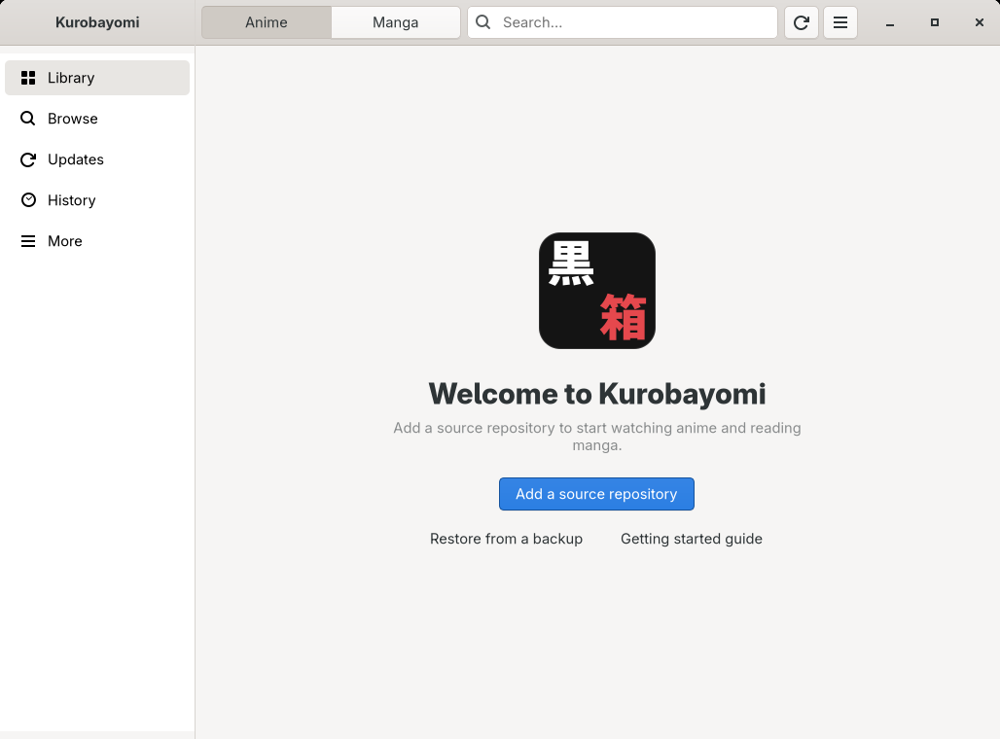
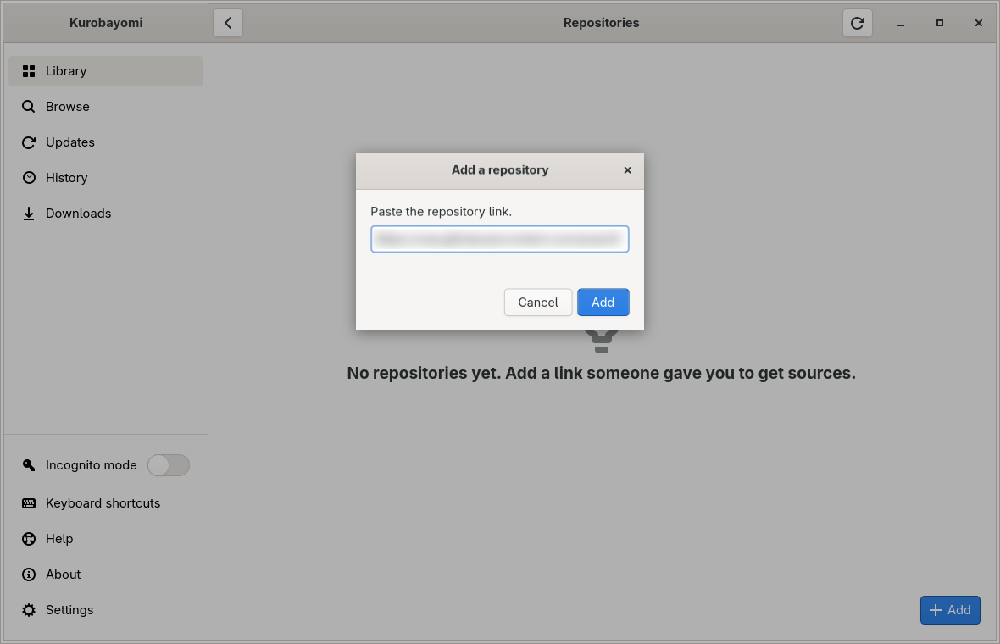
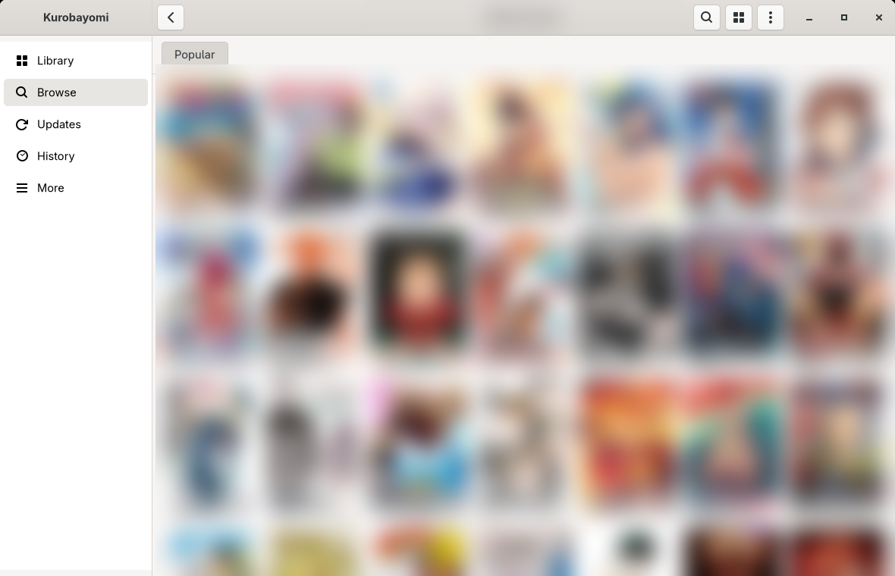
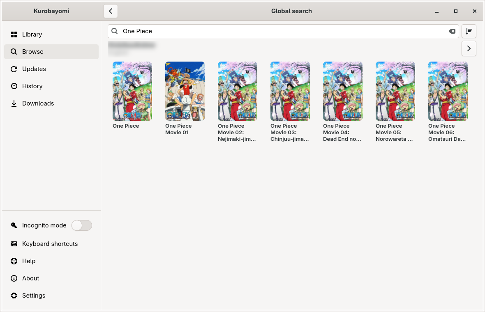
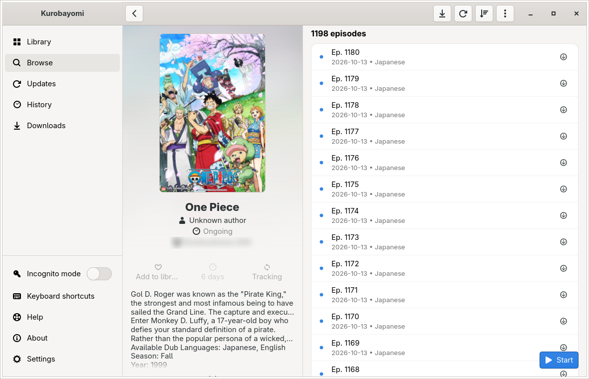

<p align="center">
  
</p>

<h1 align="center">Kurobayomi</h1>

<p align="center">Watch anime and read manga on the Linux desktop.</p>

<p align="center">
  <a href="https://github.com/anas1412/kurobayomi/releases"></a>
  <a href="https://github.com/anas1412/kurobayomi/releases/latest"></a>
  <a href="https://github.com/anas1412/kurobayomi/actions/workflows/ci.yml"></a>
  <a href="https://github.com/anas1412/kurobayomi/releases/tag/nightly"></a>
  <a href="LICENSE"></a>
</p>

Kurobayomi is a native desktop app, written in Rust with GTK4, that follows the model of
[Aniyomi](https://github.com/aniyomiorg/aniyomi): a library, a reader, a video player, sources you add yourself, and
progress tracking. It follows your GTK theme and draws its own icons, so it looks right on any desktop.

The name is *kurobako* (黒箱, "black box") plus *-yomi* ("reading").



> **Status: early test version.** It runs, and the whole flow from adding a repository to watching or reading works, but
> expect rough edges. A nightly AppImage is built from every change and updates itself; the first stable release is
> coming. See [Install](#install).

## What it does

- **Sources you add.** The app ships with no sources. Paste a repository link someone gave you and its sources appear
  at once; there is nothing to install. Sources are small files (text recipes or sandboxed WASM plug-ins) that are
  checked and updated every day.
- **One search for everything.** Search all your sources at once from Browse.
- **Anime player inside the app**, built on mpv: quality and server, subtitles and audio, speed, a Skip button for openings
  and endings, and a full-screen mode that shows only the video. Your own `mpv.conf` and `input.conf` are honoured.
- **Manga reader inside the app**: left to right by default, right to left or long strip per title, the next chapter
  follows the last page.
- **Library, Updates and History**, downloads for offline use, and AniList tracking (optional).
- **Aniyomi and Tachiyomi backups** (`.tachibk`) restore into Kurobayomi, and `aniyomi://` / `tachiyomi://` repository
  links open it.
- **Keeps itself up to date.** The AppImage downloads a newer version in the background and runs it after a restart;
  About shows the progress.
- **Fits any window size**, from a full screen down to a phone-sized 360 px: the sidebar turns into a bar at the bottom.

<table>
  <tr>
    <td></td>
    <td></td>
  </tr>
  <tr>
    <td></td>
    <td></td>
  </tr>
</table>

<sub>Site names, the repository link and the covers in lists are blurred in these screenshots.</sub>

## Getting started

The step-by-step guide, with screenshots, is in **[docs/GETTING-STARTED.md](docs/GETTING-STARTED.md)**. In short:

1. Open the app and click **Add a source repository**.
2. Paste the repository link.
3. Click the search button 🔍 next to **Kurobayomi**, type a title and press **Enter**, open a title, click **Start**.

Downloads and backups go to `~/Kurobayomi` unless you pick another folder in Settings.

## Sources and repositories

Kurobayomi does not host, list or recommend any content or website. A repository is a link to an `index.min.json` file
that lists sources; anyone can publish one. The format, the plug-in interface and an example repository are in
[kurobayomi-extensions](https://github.com/anas1412/kurobayomi-extensions).

## Install

### AppImage

Download the AppImage, make it executable and run it. It carries its own libraries and needs glibc 2.39 or newer
(Ubuntu 24.04, Fedora 40, Debian 13, Arch and newer).

- **Nightly** (built from every change, may be unstable, keeps its data apart from the stable app):
  [Kurobayomi-nightly-x86_64.AppImage](https://github.com/anas1412/kurobayomi/releases/download/nightly/Kurobayomi-nightly-x86_64.AppImage)
- **Stable**: [Kurobayomi-x86_64.AppImage](https://github.com/anas1412/kurobayomi/releases/latest/download/Kurobayomi-x86_64.AppImage)
  once the first release is out.

```bash
chmod +x Kurobayomi-nightly-x86_64.AppImage
./Kurobayomi-nightly-x86_64.AppImage
```

The AppImage updates itself: at start it looks for a newer version, downloads it in the background and runs it after a
restart. **About** shows the progress, and **Check for updates at startup** there turns it off. AppImage managers
(Gear Lever, AppImageLauncher) work too.

A Flatpak is planned.

### From source

You need a recent stable Rust, GTK 4.14 or newer, and libmpv (on Arch: `pacman -S gtk4 mpv`; on Fedora:
`dnf install gtk4-devel mpv-libs-devel`; on Ubuntu 24.04: `apt install libgtk-4-dev libmpv-dev`).

```bash
git clone https://github.com/anas1412/kurobayomi.git
cd kurobayomi
cargo build --release
./target/release/kurobayomi
```

## For developers

```bash
cargo run                      # run the app
cargo test --workspace         # all tests
```

Developer switches: `KUROBAYOMI_SIZE=WxH` (window size), `KUROBAYOMI_OPEN=<screen id>` (open a screen at start),
`KUROBAYOMI_SHOT=file.png` (render the window to a PNG and quit), `KUROBAYOMI_SHOT_DIR=dir` (create `dir/take` to save
every open window as a PNG; used for the guide's screenshots).

| Path | What it is |
|---|---|
| `src/` | the GTK4 app: screens, player and reader views |
| `crates/kuro-platform` | all OS-specific code (paths, secrets), so a Windows port stays possible |
| `crates/kuro-prefs`, `kuro-db`, `kuro-data`, `kuro-domain` | settings, databases, repositories, domain rules |
| `crates/kuro-extensions`, `kuro-source*`, `kuro-net` | repositories, the recipe engine, the WASM plug-in host, HTTP |
| `crates/kuro-player`, `kuro-downloads`, `kuro-images`, `kuro-local`, `kuro-archive` | mpv player, downloads, images, local files, CBZ |
| `crates/kuro-backup`, `kuro-track` | backups (Aniyomi compatible), AniList tracking |
| `docs/` | the user guide, design notes and audits |

## Licence

Apache License 2.0, see [LICENSE](LICENSE). Kurobayomi is derived from Aniyomi, Mihon and Tachiyomi, which use the same
licence; see [NOTICE](NOTICE).
