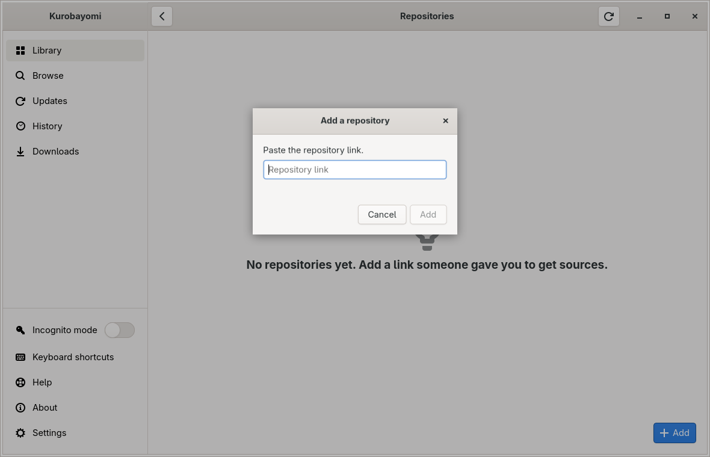
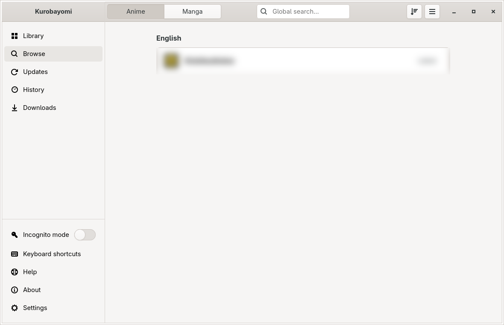
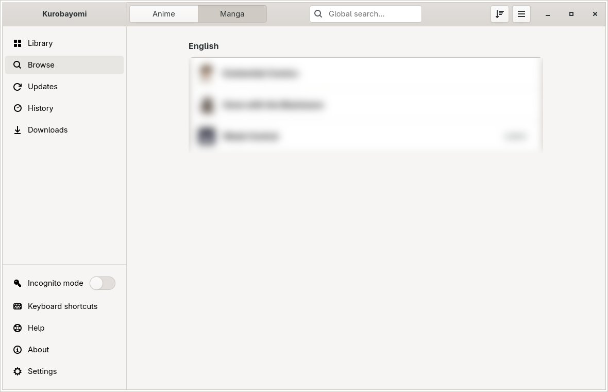
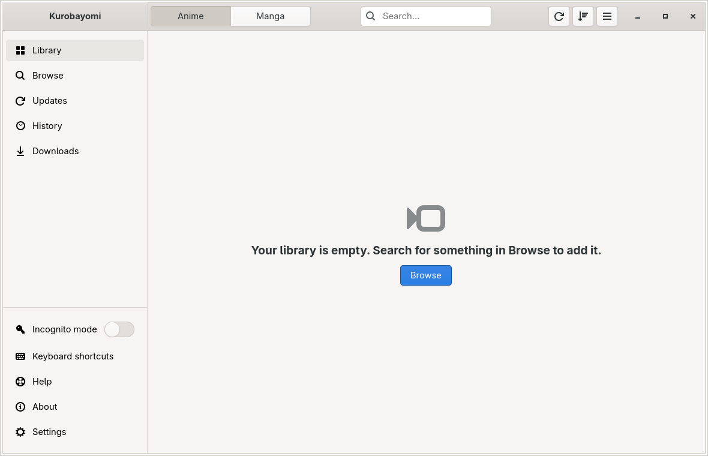

# Getting started with Kurobayomi

Kurobayomi lets you watch anime and read manga on your computer. It comes with no sources of its own: you add a
**repository**, a link that someone you trust gives you, and its sources show up in the app.

This guide takes about five minutes.

---

## 1. Open the app

The first time you open Kurobayomi, you see the welcome screen.

There is nothing to set up first. Downloads and backups go to a **Kurobayomi** folder in your home folder;
you can change that later in Settings.

## 2. Add a repository

1. Click **Add a source repository**.
2. A small window opens. Paste the repository link you were given.

   

3. Click **Add**.

   

Kurobayomi downloads the repository's sources. This takes a few seconds.

> **Tip:** if a website shows an **Add to Aniyomi** or **Add to Tachiyomi** button for a repository, clicking it in your
> browser opens Kurobayomi with the link already filled in.

## 3. Your sources

When the repository is added, Kurobayomi takes you to **Browse**. Use the **Anime** and **Manga** buttons at the top to
switch between the two kinds of sources.

Click a source to see what it has. The **Popular** list opens first.

## 4. Search

To find something, type in the search box at the top of **Browse** and press **Enter**. Kurobayomi looks through all
your sources at once and shows the results per source.

## 5. Watch or read

Click a title to open its page. You see the cover, the details and the list of episodes or chapters.

- Click **Start** to begin, or **Resume** to go on where you stopped.
- Click **Add to library** to keep the title in your **Library**.

**Anime** plays inside the app. The player has pause, the time bar, volume, the next and previous episode, a menu for
quality and server, a menu for subtitles and audio, and speed. The full-screen button shows only the video; press
**Esc** to leave full screen. When an opening or an ending plays, a **Skip** button appears.

**Manga** opens in the reader. Turn pages with the arrow keys, the space bar or the mouse wheel. The last page of a
chapter leads straight into the next one.

Kurobayomi remembers where you stopped in every title.

## 6. Your library

Titles you add show up in **Library**. Until you add one, the Library tells you how to find something.

The sidebar also has:

- **Updates**: new episodes and chapters of the titles in your library.
- **History**: what you watched and read recently.
- **Downloads**: shows up while something downloads, with how many are left.
- **Settings**: the gear at the bottom of the sidebar.

Incognito mode, keyboard shortcuts, help and About are in the menu on the **Kurobayomi** title.

---

## Where your files are saved

Downloads and backups go to **Kurobayomi** in your home folder: **Anime** and **Manga** hold the downloads,
**Backups** the backups and **Local** your own folders. To use another folder, open **Settings → Data and storage**
and click **Storage location**. The new folder is used for new downloads after a restart; files already downloaded
stay where they are.

## Restore a backup

You can bring back a backup from Kurobayomi, Aniyomi or Tachiyomi (a file that ends in `.tachibk`):

- On the welcome screen, click **Restore from a backup**, or
- open **Settings → Data and storage** and click **Restore backup**.

## Connect AniList (optional)

To keep your progress on AniList, open **Settings → Sources and tracking** and log in to AniList. You can skip
this.

## If a source is not working

A source can stop working when its website changes. Kurobayomi then shows a short message with a **Retry** button.

1. Click **Retry**, or try again later.
2. Repositories are checked for fixes every day, so a source that fails today often works again after the next update.

If a source keeps failing, it shows **Not working right now** in the Browse list.
