# 24-downloads-anime: behaviour spec

All source paths are repo-relative to `/home/blackbox/aniyomi-src`. Line numbers refer to the files as they are on disk. Items labelled **OBSERVED** describe what the Kotlin does. Items labelled **Proposal:** describe what Kurobayomi should do. Items labelled **Defect (observed)** are behaviour that is almost certainly unintended; the Rust port should fix them unless noted.

Package root for every file in this document: `app/src/main/java/eu/kanade/tachiyomi/data/download/anime/` (abbreviated `DL/` below). UI files: `app/src/main/java/eu/kanade/tachiyomi/ui/download/anime/` (abbreviated `UI/`).

---

## 1. Concepts and vocabulary

- **Download (queue element)**: `DL/model/AnimeDownload.kt:16-22`. Fields: `source: AnimeHttpSource`, `anime: Anime`, `episode: Episode`, `changeDownloader: Boolean = false`, `video: Video? = null`. Implements `ProgressListener`.
- **Status**: `AnimeDownload.State` (`DL/model/AnimeDownload.kt:62-68`): `NOT_DOWNLOADED(0)`, `QUEUE(1)`, `DOWNLOADING(2)`, `DOWNLOADED(3)`, `ERROR(4)`. Ordering matters: "active" means `status.value <= DOWNLOADING.value` (0..2).
- **Queue**: ordered list of downloads, held in `AnimeDownloader._queueState` (`DL/AnimeDownloader.kt:100`). Position in the list is the download order. The first item of each source group is the one scheduled next.
- **Staging dir**: `<episodeDirName>_tmp` (`TMP_DIR_SUFFIX = "_tmp"`, `DL/AnimeDownloader.kt:939`). Finished episode dir has no suffix.
- **Episode dir name**: `DL/AnimeDownloadProvider.kt:427-435` (see §9).

### 1.1 Status state machine (per download)

```mermaid
stateDiagram-v2
    [*] --> QUEUE: queueEpisodes / addAllToQueue (status set to QUEUE, DL/AnimeDownloader.kt:863)
    QUEUE --> DOWNLOADING: launchDownloadJob runs downloadEpisode, getOrDownloadVideoFile sets DOWNLOADING (DL/AnimeDownloader.kt:438)
    DOWNLOADING --> DOWNLOADED: finalize succeeds (DL/AnimeDownloader.kt:390)
    DOWNLOADING --> ERROR: isDownloadSuccessful false (DL/AnimeDownloader.kt:378), catch in downloadEpisode (DL/AnimeDownloader.kt:395), disk space, or stop() (DL/AnimeDownloader.kt:162)
    QUEUE --> ERROR: stop() does not touch QUEUE; only DOWNLOADING becomes ERROR
    ERROR --> QUEUE: start() re-queues every non-DOWNLOADED item (DL/AnimeDownloader.kt:148)
    DOWNLOADING --> QUEUE: pause() (DL/AnimeDownloader.kt:185) or updateQueue
    QUEUE --> NOT_DOWNLOADED: removeFromQueue / internalClearQueue (DL/AnimeDownloader.kt:874, 910)
    DOWNLOADING --> NOT_DOWNLOADED: removeFromQueue / internalClearQueue (DL/AnimeDownloader.kt:874, 910)
    DOWNLOADED --> [*]: removed from queue by launchDownloadJob (DL/AnimeDownloader.kt:258)
```



Notes:
- `ERROR` items are never removed automatically. They stay in the queue and in the store until the user cancels them or they succeed on a retry.
- `NOT_DOWNLOADED` is only ever assigned to items that were removed or cleared. An item removed from the queue keeps `NOT_DOWNLOADED` in memory, which lets an in-flight coroutine detect removal.

---

## 2. Downloader engine: the queue and scheduler (`DL/AnimeDownloader.kt`)

### 2.1 Startup restore

- `init` (`DL/AnimeDownloader.kt:129-134`): on the IO scope, call `store.restore()` and pass the result to `addAllToQueue`. Restore reads all entries, sorts by `order`, rebuilds `AnimeDownload` objects using `getAnime.await(animeId)`, `sourceManager.get(anime.source) as? AnimeHttpSource`, and `getEpisode.await(episodeId)`. Entries that fail any lookup are silently skipped (`?: continue`). Then the store is cleared and immediately rebuilt by `addAllToQueue`, so surviving entries are re-persisted with fresh order values starting at 0.
- Restore does not start downloads. The user must press Resume or a job must be started.
- **Defect (observed, minor)**: an episode whose source is not installed at restart is removed from the store permanently (no retry when the extension returns).

### 2.2 `start()` (`DL/AnimeDownloader.kt:142-153`)

1. If `isRunning` (downloader job active) or queue is empty, return `false`.
2. `pending = queue.filter { status != DOWNLOADED }`.
3. For each pending item whose status is not `QUEUE`, set status to `QUEUE`. This converts `ERROR` and `DOWNLOADING` leftovers into `QUEUE` (this is the retry trigger for errored items).
4. `launchDownloaderJob()`.
5. Return `pending.isNotEmpty()`.

### 2.3 `launchDownloaderJob()` (`DL/AnimeDownloader.kt:201-247`)

Runs on `CoroutineScope(SupervisorJob() + Dispatchers.IO)` (`DL/AnimeDownloader.kt:111`). Stored in `downloaderJob`.

Scheduler flow (`activeDownloadsFlow`, `transformLatest` over `queueState`):

```
loop:
  activeDownloads = queue
      .filter { status.value <= DOWNLOADING.value }   // NOT_DOWNLOADED, QUEUE, DOWNLOADING
      .groupBy { source }                              // key: the AnimeSource object
      .toList()
      .take(3)                                         // max 3 sources in flight
      .map { (_, group) -> group.first() }             // one download per source
  emit(activeDownloads)
  if activeDownloads is empty: break
  wait until any item in activeDownloads has status == ERROR     // combine(statusFlows) { contains(ERROR) }.filter{it}.first()
after loop: if areAllAnimeDownloadsFinished() then stop()         // no reason argument
```

`distinctUntilChanged()` applies to the emitted lists.

Per emission, `collectLatest` (`DL/AnimeDownloader.kt:233-244`):
1. `downloadJobsToStop` = entries in `downloadJobs` whose key is not in the new list; cancel each job and remove it.
2. `downloadsToStart` = new list items not in `downloadJobs`; for each, `downloadJobs[d] = launchDownloadJob(d)`.

Concurrency rule in one sentence: at most one download per source runs at a time, and at most three sources run concurrently. The first download of a source group that is not ERROR, DOWNLOADED or NOT_DOWNLOADED-pending is chosen. `groupBy` preserves first-occurrence order, so the source whose earliest queued item is earliest in the queue is scheduled first.

- **Note on the comment**: the source comment at `DL/AnimeDownloader.kt:212` says "Concurrently download from 5 different sources", but the constant is `take(3)`. The code value (3) is the behaviour. Proposal: keep 3 and fix the comment.
- **Note**: `DOWNLOADED` items stay in the queue for a moment, but they are excluded by the `<= DOWNLOADING` filter. They are removed by `launchDownloadJob` right after success.

### 2.4 `launchDownloadJob(download)` (`DL/AnimeDownloader.kt:252-267`)

```
try:
    downloadEpisode(download)
    if download.status == DOWNLOADED: removeFromQueue(download)
catch Throwable e:
    if e is CancellationException: rethrow
    logcat(ERROR, e)
    notifier.onError(e.message)          // no episode or anime context
    stop()                               // stops the WHOLE downloader
```

Only unexpected exceptions escape `downloadEpisode`. Per-episode failures are handled inside `downloadEpisode` and leave the download in `ERROR` without stopping the downloader. The catch-all therefore stops everything.

### 2.5 `stop(reason)` (`DL/AnimeDownloader.kt:158-176`)

1. `cancelDownloaderJob()` (cancels `downloaderJob`, sets it to null).
2. Every `DOWNLOADING` item becomes `ERROR`.
3. If `reason != null`: `notifier.onWarning(reason)` and return. The `AnimeDownloadJob.stop(context)` call is skipped on this path.
4. Otherwise, if queue is non-empty: `notifier.onPaused()`. If queue is empty: `notifier.onComplete()`.
5. `AnimeDownloadJob.stop(context)`.

- **Defect (observed)**: `stop()` after a normal run that left ERROR items in the queue shows the "Episode download paused" notification (`onPaused`), not a completion message. The code does not distinguish "paused by user" from "finished with errors".

### 2.6 `pause()` (`DL/AnimeDownloader.kt:181-186`)

Cancel the downloader job. Every `DOWNLOADING` item becomes `QUEUE`. No notification. The in-flight ffmpeg session is cancelled through `invokeOnCancellation` (see §5.3). Partial output is deleted (see §5.5), so pausing discards progress for the active item.

### 2.7 `clearQueue()` (`DL/AnimeDownloader.kt:191-196`)

Cancel job; `internalClearQueue()`; `notifier.dismissProgress()` (cancels notification ID -203). `internalClearQueue` (`DL/AnimeDownloader.kt:904-916`) sets `DOWNLOADING` and `QUEUE` items to `NOT_DOWNLOADED`, leaves `ERROR` untouched, calls `store.clear()`, then sets the queue to empty.

Note: `AnimeDownloadManager.clearQueue()` (`DL/AnimeDownloadManager.kt:332-335`) calls `downloader.clearQueue()` then `downloader.stop()`. The second call re-enters `stop()` with an empty queue, so it calls `notifier.onComplete()` and `AnimeDownloadJob.stop`.

### 2.8 `queueEpisodes(anime, episodes, autoStart, changeDownloader, video)` (`DL/AnimeDownloader.kt:284-336`)

1. If `episodes` is empty, return.
2. `source = sourceManager.get(anime.source) as? AnimeHttpSource ?: return`. Non-HTTP sources (for example local) are silently ignored.
3. `wasEmpty = queue.isEmpty()`.
4. Build `episodesToQueue` from `episodes` in this order:
   a. filter: `provider.findEpisodeDir(it.name, it.scanlator, anime.title, source) == null` (not already downloaded under either the current or the legacy dir name, see §9);
   b. `sortedByDescending { it.sourceOrder }`;
   c. filter: no element of the queue has the same `episode.id`;
   d. map to `AnimeDownload(source, anime, episode, changeDownloader, video)`.
5. If non-empty: `addAllToQueue(episodesToQueue)` (appends to the END of the queue).
6. If `autoStart && wasEmpty`:
   - `queuedDownloads = count of queue items whose source !is UnmeteredSource`
   - `maxDownloadsFromSource = max group size over queue items grouped by source, filtered to !is UnmeteredSource` (0 if none)
   - If `queuedDownloads > 20` or `maxDownloadsFromSource > 10`: `notifier.onWarning(AYMR.download_queue_size_warning, timeout = 30_000 ms, contentIntent = openUrl(HELP_WARNING_URL))`.
   - `AnimeDownloadJob.start(context)`.
- **Note**: `autoStart && wasEmpty`. If the queue already had items, autoStart does not start the job even when the downloader is stopped. The user must press Resume. If the downloader is already running, new items are picked up by the flow without a start call.
- `HELP_WARNING_URL` is `AnimeLibraryUpdateNotifier.HELP_WARNING_URL` (owned by area:26-library-update-jobs).

Manager-side entry point `AnimeDownloadManager.downloadEpisodes(anime, episodes, autoStart = true, alt = false, video = null)` (`DL/AnimeDownloadManager.kt:376-385`) first filters fillermarked episodes (§8) and then calls `queueEpisodes(anime, filtered, autoStart, alt, video)`. The `alt` argument is passed as `changeDownloader`, which selects the alternative downloader (§5.1).

### 2.9 `addDownloadsToStartOfQueue` (`DL/AnimeDownloadManager.kt:392-399`)

Empty input: return. Otherwise `queue = addAll(0, downloads)`, `reorderQueue(queue)`, and if `!AnimeDownloadJob.isRunning(context)` call `startDownloads()`. Used by reader and player "download next" paths (outside this area).

### 2.10 `startDownloadNow(episodeId)` (`DL/AnimeDownloadManager.kt:347-357`)

1. `existing = queue.find { episode.id == episodeId }`.
2. `toAdd = existing ?: runBlocking { AnimeDownload.fromEpisodeId(episodeId) } ?: return`.
3. Copy the queue, remove `existing` if present, insert `toAdd` at index 0, `reorderQueue(copy)`.
4. `startDownloads()`.

- **Note**: no check that the episode is already downloaded (`fromEpisodeId` does not check the file system). Starting an already-downloaded episode re-downloads into a new staging dir and finalises by renaming over the existing name, which fails on the rename and leaves the item in ERROR. Observed, unhandled.

### 2.11 `reorderQueue` and `updateQueue` (`DL/AnimeDownloadManager.kt:364-366`, `DL/AnimeDownloader.kt:918-936`)

`updateQueue(downloads)`:
1. `if (queueState == downloads) return` — **Defect (observed)**: compares a `StateFlow` object with a `List`; always false. The short-circuit never runs. Harmless but dead.
2. If `downloads` is empty: `clearQueue(); stop(); return`.
3. `wasRunning = isRunning`.
4. `pause()`; `internalClearQueue()`; `addAllToQueue(downloads)` (items keep their object identity, statuses reset to QUEUE, store rewritten with new counter order).
5. If `wasRunning`: `start()`.

Order is the order of `downloads`. The counter for store order is per process (`AnimeDownloadStore.counter`, `DL/AnimeDownloadStore.kt:181`), so order is preserved across restart.

### 2.12 `cancelQueuedDownloads(downloads)` and `removeFromDownloadQueue`

`cancelQueuedDownloads` maps to `removeFromDownloadQueue(episodes)` (`DL/AnimeDownloadManager.kt:552-567`):
1. `wasRunning = downloader.isRunning`; if so, `downloader.pause()`.
2. `downloader.removeFromQueue(episodes)` (matches by `episode.id`; `removeFromQueueIf` at `DL/AnimeDownloader.kt:880-893`: removes matching items from the store, sets `DOWNLOADING`/`QUEUE` to `NOT_DOWNLOADED`, removes them from the list).
3. If `wasRunning`: if queue empty, `downloader.stop()`; else `downloader.start()`.

Removal by anime (`AnimeDownloader.removeFromQueue(anime)`, `DL/AnimeDownloader.kt:900-902`) uses `anime.id` and does NOT pause or resume the running downloader. **Observed difference**: deleting an anime's downloads cancels queued items but relies on the running coroutine to notice the removal.

### 2.13 Removal from queue after success

`removeFromQueue(download)` (`DL/AnimeDownloader.kt:870-878`): `store.remove(download)`; if status is `DOWNLOADING` or `QUEUE`, set `NOT_DOWNLOADED`; remove the element. Called from `launchDownloadJob` after `DOWNLOADED`, and from the ADM external path (§5.4).

### 2.14 Event flows exposed to UI (`DL/AnimeDownloadManager.kt:674-702`)

- `statusFlow()`: `queueState.flatMapLatest { merge(each item.statusFlow.drop(1).map { item }) }`, with `onStart` emitting current `DOWNLOADING` items. Emits the item on every status change after the initial value.
- `progressFlow()`: same shape over `progressFlow` (integer progress).
- Both are rebuilt when the queue list changes (`flatMapLatest`).

---

## 3. Enqueue-time and delete-time filters (`DL/AnimeDownloadManager.kt`)

### 3.1 Download-time filter: fillermark

`getEpisodesToDownload(episodes)` (`DL/AnimeDownloadManager.kt:666-672`): if `downloadFillermarkedItems()` is false (default), drop episodes with `fillermark == true`. Preference key `pref_download_fillermarked`, default `false` (`domain/src/main/java/tachiyomi/domain/download/service/DownloadPreferences.kt:37`).

### 3.2 Delete-time filter: bookmarked and category exclusion

`getEpisodesToDelete(episodes, anime)` (`DL/AnimeDownloadManager.kt:645-664`):

```
categoriesToExclude = removeExcludeAnimeCategories().get().map(String::toLong)   // default emptySet
categoriesForAnime  = getCategories.await(anime.id).map { it.id }.ifEmpty { listOf(0) }
filteredCategoryAnime =
    if (categoriesForAnime ∩ categoriesToExclude is non-empty)  episodes.filterNot { it.seen }
    else                                                        episodes
result =
    if (!removeBookmarkedChapters())  filteredCategoryAnime.filterNot { it.bookmark }
    else                              filteredCategoryAnime
```

Interpretation: if the anime sits in a category listed in `remove_exclude_anime_categories` (defaults empty), watched episodes are protected from deletion. Bookmarked episodes are protected unless `pref_remove_bookmarked` (default `false`) is true. Note that the category check protects watched episodes by excluding them, which is the opposite of how the name reads, so keep the logic exactly as written.

`getEpisodesToDelete` is applied in two places:
- `enqueueEpisodesToDelete` (remove-after-watched path, §7);
- `deleteEpisodes` (every explicit delete, §6.2). Explicit delete from the UI therefore honours the same protections.

The `ifEmpty { listOf(0) }` means an anime in no category is treated as being in the default category 0.

---

## 4. Start, stop and job lifecycle (`DL/AnimeDownloadManager.kt`, `DL/AnimeDownloadJob.kt`)

### 4.1 `AnimeDownloadManager.startDownloads()` (`DL/AnimeDownloadManager.kt:312-320`)

1. If `downloader.isRunning`, return.
2. If `AnimeDownloadJob.isRunning(context)` (a WorkManager unique work in state RUNNING): `downloader.start()`.
3. Else `AnimeDownloadJob.start(context)`.

`pauseDownloads()` = `downloader.stop()` (no reason; so this shows the "paused" notification).

### 4.2 `AnimeDownloadJob` (`DL/AnimeDownloadJob.kt`)

WorkManager `CoroutineWorker`. Unique work name `TAG = "AnimeDownloader"` (`DL/AnimeDownloadJob.kt:103`). `start` enqueues a `OneTimeWorkRequest` with `ExistingWorkPolicy.REPLACE` (`:110`). `stop` cancels unique work (`:115`). `isRunning` = exactly one work info in state RUNNING (`:122`). `isRunningFlow` = the same over LiveData (`:129`).

`getForegroundInfo()` (`:40-54`): notification on channel `CHANNEL_DOWNLOADER_PROGRESS`, title `R.string.download_notifier_downloader_title` ("Downloader"), small icon `android.R.drawable.stat_sys_download`, notification ID `Notifications.ID_DOWNLOAD_EPISODE_PROGRESS` (-203), type `FOREGROUND_SERVICE_TYPE_DATA_SYNC` on API 29+.

`doWork()` (`:56-85`), as written:

```
networkCheck = checkNetworkState(activeNetworkState(), downloadOnlyOverWifi().get())
active = networkCheck && downloadManager.downloaderStart()
if (!active) return Result.failure()
setForegroundSafely()
coroutineScope {
    combineTransform(networkStateFlow(), downloadOnlyOverWifi().changes()) { a, b -> emit(checkNetworkState(a, b)) }
        .onEach { networkCheck = it }
        .launchIn(this)
}
while (active) { active = !isStopped && downloadManager.isRunning && networkCheck }
return Result.success()
```

**Defect (observed, high)**: `coroutineScope { ... launchIn(this) }` suspends until all children finish. The network flow never completes, so the block never returns and the `while (active)` loop below is unreachable. Consequences:
- The worker stays alive until it is cancelled (by `AnimeDownloadJob.stop`) or the process dies.
- After a network-induced stop (`downloaderStop(reason)` does not cancel the work), `networkCheck` becomes `false` but nothing calls `downloaderStart()` when the network returns. Downloads do not resume automatically on reconnect. Confirm at runtime before relying on this either way.
- The `while` loop, if it were reachable, is a busy spin with no suspension point. It must not be ported.

`checkNetworkState(state, requireWifi)` (`:87-100`):
- If `state.isOnline`:
  - `noWifi = requireWifi && !state.isWifi`;
  - if `noWifi`: `downloaderStop(R.string.download_notifier_text_only_wifi)` ("No Wi-Fi connection available");
  - return `!noWifi`.
- Else: `downloaderStop(R.string.download_notifier_no_network)` ("No network connection available") and return `false`.

Note: an Ethernet-connected machine with Wi-Fi-only enabled (the default) is treated as "no Wi-Fi" and the downloader stops with the Wi-Fi warning. See §10.2 for the Linux mapping.

### 4.3 Wi-Fi and network preference

`downloadOnlyOverWifi` key `pref_download_only_over_wifi_key`, default `true` (`DownloadPreferences.kt:9-12`).

---

## 5. Downloading one episode (`DL/AnimeDownloader.kt`)

### 5.1 Path choice

`downloadEpisode` always calls `getOrDownloadVideoFile`, which chooses between the internal path and the external path:

```
if (preferences.useExternalDownloader().get() == download.changeDownloader)   // DL/AnimeDownloader.kt:442
    internal path (progress job, optional local HTTP server, downloadVideo)
else
    external path (optional HTTP server via MainActivity.startHttpServerService, downloadVideoExternal)
```

Defaults: `use_external_downloader` = `false`; `changeDownloader` = `false` for normal enqueues. So by default the internal path is used. A single enqueue with `alt = true` flips to the external path. Caller at `ui/entries/anime/AnimeScreenModel.kt:943` passes `alt` from a per-action flag.

### 5.2 `downloadEpisode(download)` algorithm (`DL/AnimeDownloader.kt:343-403`)

```
animeDir = provider.getAnimeDir(anime.title, source)         // creates dirs (UniFile.createDirectory) or throws invalid_location
availSpace = DiskUtil.getAvailableStorageSpace(animeDir)
if (availSpace != -1 && availSpace < 200 MiB):
    status = ERROR; notifier.onError(download_insufficient_space, episode.name, anime.title, anime.id); return
episodeDirname = provider.getEpisodeDirName(episode.name, episode.scanlator)
tmpDir = animeDir.createDirectory(episodeDirname + "_tmp")!!
try:
    if download.video == null:
        hosters = EpisodeLoader.getHosters(episode, anime, source)
        if hosters empty: throw Exception(video_list_empty_error)
        bestVideo = HosterLoader.getBestVideo(source, hosters) ?: throw Exception(video_list_empty_error)
        download.video = bestVideo
    withIOContext { getOrDownloadVideoFile(download, tmpDir) }
    if (!isDownloadSuccessful(download, tmpDir)): status = ERROR; return
    filename = buildValidFilename("${anime.title} - ${episode.name}")
    tmpDir.findFile("${filename}_tmp.mkv")?.delete()
    tmpDir.renameTo(episodeDirname)
    cache.addEpisode(episodeDirname, animeDir, anime)
    DiskUtil.createNoMediaFile(tmpDir, context)
    status = DOWNLOADED
catch Throwable error:
    if CancellationException: rethrow
    logcat(ERROR, error)
    status = ERROR
    notifier.onError(error.message, episode.name, anime.title, anime.id)
```

- The `tmpDir` is created before the try, so a failure to create it escapes to `launchDownloadJob` and stops the downloader (§2.4).
- `error.message` is passed to the notifier verbatim. For the three `Exception("...")` throws with localized messages, the message is the localized text. The `Failed to start server` and `Error in ffmpeg!` messages are English literals.
- `DiskUtil.getAvailableStorageSpace(UniFile)` uses `StatFs(f.uri.path)` (`core/common/src/main/java/eu/kanade/tachiyomi/util/storage/DiskUtil.kt:75-82`). It returns `-1` on failure, which disables the check.
- `MIN_DISK_SPACE = 200L * 1024 * 1024` = 209,715,200 bytes (`DL/AnimeDownloader.kt:947`). The check uses strict less-than.

### 5.3 `getOrDownloadVideoFile(download, tmpDir)` (`DL/AnimeDownloader.kt:411-490`)

```
video = download.video!!
video.status = LOAD_VIDEO
filename = buildValidFilename(episode.name)                  // NOTE: episode name only, no anime title
tmpDir.findFile("$filename.tmp")?.delete()
videoFile = tmpDir.listFiles()?.firstOrNull { it.name!!.startsWith("$filename.mkv") }
try:
    file = if videoFile != null: videoFile      // resume: finished remux found, skip download
           else:
             notifier.onProgressChange(download)
             download.status = DOWNLOADING; download.progress = 0
             if (useExternal == changeDownloader):          // internal path
                 progressJob = scope.launch { while status == DOWNLOADING { delay(50); notifier.onProgressChange(download) } }
                 if video.usesHttpServer():
                     httpServer = download.source.createHttpServer(); httpServer.start()
                     download.video = download.video.copyHttpServer(httpServer.listeningPort ?: 0)
                 downloadVideo(download, tmpDir, filename)
             else:                                           // external path
                 if download.video!!.usesHttpServer():
                     (success, port) = MainActivity.startHttpServerService(context, source.id)
                     if !success: throw Exception("Failed to start server")
                     download.video = download.video!!.copyHttpServer(port)
                 betterFileName = buildValidFilename("${anime.title} - ${episode.name}")
                 downloadVideoExternal(video, source, tmpDir, betterFileName)
    video.videoUrl = file.uri.path ?: ""
    download.progress = 100
    video.status = READY
    httpServer?.stop(); progressJob?.cancel()
catch Exception e:
    httpServer?.stop()
    if CancellationException: rethrow
    video.status = ERROR
    notifier.onError(e.message, episode.name, anime.title, anime.id)
    progressJob?.cancel()
```

Details that matter for a port:
- **Filename asymmetry**: the internal path and the resume check use `buildValidFilename(episode.name)` (`"$filename.mkv"`, `"$filename.tmp"`). The external path uses `buildValidFilename("${anime.title} - ${episode.name}")`. The resume check (`startsWith("$filename.mkv")`) therefore never matches an external-path file.
- **Errors do not propagate**: `getOrDownloadVideoFile` catches `Exception`, notifies the user, and returns normally. The caller then runs `isDownloadSuccessful`. If that check fails the download is set to ERROR a second time without a second notification. Observed: two error notifications may be shown for one failure.
- **Progress job**: 50 ms poll while `status == DOWNLOADING`, calling `notifier.onProgressChange`. Only the internal path has this job.
- `download.progress = 100` is set on success, even for external handoffs (§5.4).

### 5.4 External downloader path (`downloadVideoExternal`, `DL/AnimeDownloader.kt:711-805`)

1. `file = tmpDir.createFile("${filename}_tmp.mkv")!!` — an empty placeholder file.
2. `withUIContext { context.copyToClipboard("Episode download location", tmpDir.filePath!!.substringBeforeLast("_tmp")) }`. Note the label is English and hard-coded.
3. `pkgName = preferences.externalDownloaderSelection().get()` (default `""`).
4. If `pkgName` is non-empty:
   - `intent = pm.getLaunchIntentForPackage(pkgName) ?: throw Exception("Launch intent not found")`.
   - If `pkgName` starts with `idm.internet.download.manager` (1DM): component `idm.internet.download.manager.Downloader`, action `ACTION_VIEW`, data = `video.videoUrl`, extras `extra_filename = "$filename.mkv"` and `extra_headers` = Bundle of request headers (`video.headers ?: source.headers`).
   - If `pkgName` starts with `com.dv.adm` (ADM): component `"$pkgName.AEditor"`, action `ACTION_VIEW`, extra `com.dv.get.ACTION_LIST_ADD = "${videoUrl}<info>$filename.mkv"`, `com.dv.get.ACTION_LIST_PATH = tmpDir.filePath.substringBeforeLast("_")`, extra `android.media.intent.extra.HTTP_HEADERS` = Bundle with each header value's `"http"` replaced by `"h_ttp"`. Then `file.delete()`, `tmpDir.delete()`, find the queue item whose `video == video` and set DOWNLOADED, remove it from the queue, and `stop()` if all are finished.
   - Any other `pkgName`: the intent has no component adjustments and is started as-is (only the launch intent).
5. If `pkgName` is empty: `Intent(ACTION_VIEW)` with `FLAG_ACTIVITY_NEW_TASK`, `setDataAndType(videoUrl, "video/*")`, extra `extra_filename = filename`.
6. `context.startActivity(intent)`; return `file`.
7. On any exception: delete `"${filename}_tmp.mkv"` and rethrow.

**Defect (observed, high)**: after `downloadVideoExternal` returns normally, `getOrDownloadVideoFile` marks the download READY and `progress = 100`, and `downloadEpisode` then sees one file in `tmpDir` (the placeholder) and finalises the directory as DOWNLOADED. The episode is therefore marked downloaded even though no video was received. Also `downloadEpisode` deletes `"${betterFileName}_tmp.mkv"` before the rename, which removes the placeholder, so the finalised directory is empty. `buildVideo` will then fail with `video_list_empty_error`. Proposal: the external path must not finalise on handoff; it should finalise only when the external tool reports completion, or it should be removed (see T-24a-024).

The ADM path has the mirror problem: `tmpDir.delete()` removes the staging dir, so `isDownloadSuccessful` gets `listFiles() == null` and the item goes to ERROR silently.

### 5.5 Internal download: `downloadVideo` with retry (`DL/AnimeDownloader.kt:499-531`)

```
flow {
    tmpDir.findFile("$filename.tmp")?.delete()
    videoFile = tmpDir.createFile("$filename.tmp")!!
    try:
        if (torrServerEnable && isTorrent(download.video)) torrentDownload(...)
        else                                               ffmpegDownload(...)
    catch Exception e: videoFile.delete(); throw e
    emit(videoFile)
}
.retryWhen { _, attempt -> if (attempt < 3) { delay((2L shl attempt) * 1000); true } else false }
.flowOn(Dispatchers.IO).first()
```

Retry schedule (exact): failure 1 waits 2000 ms, failure 2 waits 4000 ms, failure 3 waits 8000 ms, failure 4 is final. Total of 4 attempts and 14 s of waiting. Each retry deletes the partial `.tmp` file first (`videoFile.delete()` in the catch, and the `findFile(...).delete()` at the start of the flow).

Cancellation: a cancelled coroutine is not retried. The catch rethrows `CancellationException` after deleting the partial file, so pausing discards partial output.

`isTorrent(video)` (`:533-536`): `videoUrl` is non-null and (`startsWith("magnet")` or `endsWith(".torrent")` or `startsWith(torrentServerApi.hostUrl)`). Only used when `torrServerEnable` is true.

### 5.6 Torrent path (`torrentDownload`, `DL/AnimeDownloader.kt:538-565`)

1. `TorrentServerService.start()` (starts the torrent server if not running; see area:13-core-util-storage-archive-torrent).
2. If `videoUrl` starts with `torrentServerApi.hostUrl`: `hash = videoUrl.substringAfter("link=").substringBefore("&")`, `index = videoUrl.substringAfter("index=").substringBefore("&").toInt()` (throws on non-integer → retry), `videoUrl = "magnet:?xt=urn:btih:$hash&index=$index"`.
3. `currentTorrent = torrentServerApi.addTorrent(videoUrl, videoTitle, "", "", false)`.
4. `index = 0`; if `videoUrl` contains `index=`, parse it with `.toInt()` inside `try`, falling back to 0 on any exception.
5. `torrentUrl = torrentServerUtils.getTorrentPlayLink(currentTorrent, index)`; `video.videoUrl = torrentUrl`.
6. `ffmpegDownload(download, tmpDir, videoFile, filename)` on the torrent-server play URL (HTTP, so headers are sent).

Note the step 4 asymmetry: step 2 throws on bad `index=`, step 4 defaults to 0. Step 2 only runs for URLs on the torrent server host.

### 5.7 ffmpeg remux (`ffmpegDownload`, `DL/AnimeDownloader.kt:568-632`)

Always "safe mode" (comment at `:567`). The input is copied, never re-encoded: `-c:v copy -c:a copy -c:s copy`, container `matroska`.

Steps:
1. `headers = video.headers ?: download.source.headers`.
2. `headerOptions = headers.joinToString("", "-headers '", "'") { "${name}: ${value}\r\n" }`. The `\r\n` are real CR and LF characters in the string.
3. `FFmpegKitConfig.setLogRedirectionStrategy(ALWAYS_PRINT_LOGS)`. Log callback: forward messages whose level is `<= AV_LOG_WARNING` to logcat as ERROR (`:594-600`).
4. `statCallback`: `outTime = (s.time / 1000.0).toLong()` (seconds); if `duration != 0 && outTime > 0`: `download.progress = (100 * outTime / duration).toInt()`.
5. `duration = getDuration(ffprobe(video.videoUrl, headerOptions))?.toLong() ?: 0` (seconds, integer). ffprobe failure throws `Exception(it.output)`, which goes to retry.
6. Run ffmpeg async with the options below. On success (`returnCode.isValueSuccess`): `tmpDir.findFile("$filename.tmp")?.renameTo("$filename.mkv")`, resume. Otherwise resume with exception `"Error in ffmpeg!"`.
7. `invokeOnCancellation { session.cancel() }`.

ffprobe command: `-v quiet -show_entries format=duration -of default=noprint_wrappers=1:nokey=1 "<url>"`, prefixed by `headerOptions + " "` (always, even for local files). The output is parsed with `toFloatOrNull()`; `null` gives duration 0, which disables progress (the bar stays indeterminate).

#### 5.7.1 ffmpeg argument order (`getFFmpegOptions`, `DL/AnimeDownloader.kt:634-688`)

Each piece is a string; the joined command is parsed by `FFmpegKitConfig.parseArguments`. The final order is:

```
[videoInput] [subtitleInputs] [audioInputs]
-map 0:v
[audioMaps]
-map 0:a?
[subtitleMaps]
-map 0:s? -map 0:t?
-f matroska -c:a copy -c:v copy -c:s copy
[subtitleMetadata] [audioMetadata] [sourceVideoOptions]
"<outputPath>" -y
```

Piece definitions:
- `videoInput` = `[headerOptions if videoUrl starts with "http"]` + for each `ffmpegStreamArgs (k,v)`: `-k "v"` + `-i "videoUrl"`.
- `formatInputs(tracks)` for each track: `[headerOptions if track.url starts with "http"] -i "track.url"`, joined by single spaces, plus one trailing space.
- `formatMaps(tracks, type, offset)` = for `i` in indices: `-map {i + 1 + offset}:{type}`, joined by spaces. Subtitle maps use offset 0. Audio maps use offset `subtitleTracks.size`, so audio inputs come after subtitle inputs. Input index 0 is the video.
- `formatMetadata(tracks, type)` = for `i`: `-metadata:s:{type}:{i} "title={track.lang}"`, joined by spaces. Note: `lang` is used as the title, and it is not escaped.
- `sourceVideoOptions` = for each `ffmpegVideoArgs (k,v)`: `-k "v"`.
- Empty pieces are dropped (`filter(isNotBlank)`).
- Output path: `videoFile.uri.toFFmpegString(context)`, which is `filePath` for `file:` URIs and a SAF parameter for `content:` URIs. Double quotes are escaped as `\"`. The final `-y` overwrites the `.tmp`.

Track types: `Track(url: String, lang: String)` (`source-api/src/commonMain/kotlin/eu/kanade/tachiyomi/animesource/model/Video.kt:11`).

Consequences for a port:
- Subtitle and audio tracks are added as additional inputs, with the same headers, but only if the URL starts with `http`. Local-file tracks get no header option.
- `-map 0:a?` and `-map 0:s?` take embedded streams from the main input when present.
- `-map 0:t?` copies attachments (fonts for ASS subtitles).
- The Rust port builds an argv `Vec<String>` and does not need shell quoting. Keep the same argv order to keep output identical.

### 5.8 `isDownloadSuccessful(download, tmpDir)` (`DL/AnimeDownloader.kt:813-819`)

```
downloadedVideo = tmpDir.listFiles().orEmpty().filterNot { it.extension == ".tmp" }
return downloadedVideo.size == 1
```

**Defect (observed)**: `UniFile.extension` returns the extension without a dot, so `== ".tmp"` is never true. Any leftover `.tmp` file counts as a finished download, and the check effectively means "exactly one file in the staging directory". Proposal: check for exactly one entry whose name ends with `.mkv` and does not end with `.tmp`.

### 5.9 Finalise (`DL/AnimeDownloader.kt:382-390`)

1. `filename = buildValidFilename("${anime.title} - ${episode.name}")`.
2. Delete `"${filename}_tmp.mkv"` if present.
3. `tmpDir.renameTo(episodeDirname)`. The whole staging directory is renamed to the final episode dir name (no `_tmp`).
4. `cache.addEpisode(episodeDirname, animeDir, anime)`.
5. `DiskUtil.createNoMediaFile(tmpDir, context)` — **observed**: the `UniFile` still points at the old name after rename. `createNoMediaFile` checks `dir.exists()` first, so it may silently do nothing. Verify at runtime; the Rust port must create `.nomedia` in the final directory (T-24a-056).
6. `status = DOWNLOADED`.

`ensureSuccessfulAnimeDownload` (`DL/AnimeDownloader.kt:829-851`) is a second copy of steps 1-6 with a different check, and it is never called. Drop (T-24a-047).

---

## 6. Deleting, renaming and listing downloads (`DL/AnimeDownloadManager.kt`)

### 6.1 Read APIs

- `isEpisodeDownloaded(episodeName, episodeScanlator, animeTitle, sourceId, skipCache = false)` → `cache.isEpisodeDownloaded(...)` (`:437-451`). Cache semantics in §8.
- `getDownloadCount()` = `cache.getTotalDownloadCount()` (`:456`).
- `getDownloadCount(anime)` (`:465-472`): if `anime.source == LocalAnimeSource.ID`, count of archive files via `LocalAnimeSourceFileSystem(storageManager).getFilesInAnimeDirectory(anime.url).count { ArchiveAnime.isSupported(it) }`; else `cache.getDownloadCount(anime)`.
- `getDownloadSize()` = `cache.getTotalDownloadSize()` (`:477`).
- `getDownloadSize(anime)` (`:486-493`): local → `getAnimeDirectory(anime.url)?.size() ?: 0L`; else `cache.getDownloadSize(anime)`.
- `getQueuedDownloadOrNull(episodeId)` = `queue.find { episode.id == episodeId }` (`:343-345`).

### 6.2 `deleteEpisodes(episodes, anime, source)` (`:506-527`)

Runs in `launchIO`:
1. `filtered = getEpisodesToDelete(episodes, anime)` (§3.2). If empty, return.
2. `removeFromDownloadQueue(filtered)` (cancels queued items for those episodes, §2.12).
3. `(animeDir, episodeDirs) = provider.findEpisodeDirs(filtered, anime, source)`. `episodeDirs` contains the first of the two valid names (new, then legacy) that exists for each episode.
4. Delete every dir in `episodeDirs` (`UniFile.delete()`).
5. `cache.removeEpisodes(filtered, anime)`.
6. If `animeDir?.listFiles()?.isEmpty() == true`: `deleteAnime(anime, source, removeQueued = false)`.

### 6.3 `deleteAnime(anime, source, removeQueued = true)` (`:536-550`)

Runs in `launchIO`:
1. If `removeQueued`: `downloader.removeFromQueue(anime)` (by anime id, without pause/resume; §2.12).
2. `provider.findAnimeDir(anime.title, source)?.delete()`.
3. `cache.removeAnime(anime)`.
4. `sourceDir = provider.findSourceDir(source)`; if its `listFiles()` is empty: `sourceDir.delete()` and `cache.removeSource(source)`.

### 6.4 `renameSource(oldSource, newSource)` (`:596-614`)

Used when an extension changes its source identity (`AndroidAnimeSourceManager` calls it, outside this scope).

```
oldFolder = findSourceDir(oldSource) ?: return
newName = getSourceDirName(newSource)
if oldFolder.name == newName: return
capChanged = oldFolder.name equalsIgnoreCase newName
if capChanged:
    if !oldFolder.renameTo(newName + "_tmp"): log error; return
if !oldFolder.renameTo(newName): log error
```

The cache is not updated (no `cache` call). Proposal: invalidate the cache after a rename.

### 6.5 `renameEpisode(source, anime, oldEpisode, newEpisode)` (`:624-643`)

Called by `SyncEpisodesWithSource` (outside scope) when `isEpisodeDirNameChanged` is true.

```
oldNames = getValidEpisodeDirNames(oldEpisode.name, oldEpisode.scanlator)   // [new name, legacy name]
animeDir = getAnimeDir(anime.title, source)                                  // side effect: creates dirs
oldFolder = first existing animeDir.findFile(name) over oldNames
newName = getEpisodeDirName(newEpisode.name, newEpisode.scanlator)
if oldFolder?.name == newName: return
if oldFolder?.renameTo(newName) == true:
    cache.removeEpisode(oldEpisode, anime); cache.addEpisode(newName, animeDir, anime)
else log "Could not rename downloaded episode: <oldNames>"
```

### 6.6 `buildVideo(source, anime, episode)` (`:409-426`), used for offline playback

1. `episodeDir = provider.findEpisodeDir(episode.name, episode.scanlator, anime.title, source)`.
2. `files = episodeDir?.listFiles().orEmpty().filter { "video" in it.type.orEmpty() }` (MIME type contains "video").
3. If empty: throw `Exception(video_list_empty_error)` ("No video found").
4. `file = files[0]` (order from `listFiles`; not sorted).
5. Return `Video(videoUrl = file.uri.toString(), videoTitle = "download: " + file.uri.toString(), initialized = true)` with `status = READY`.

- The Rust port must not depend on `listFiles` order. Proposal: sort by name and prefer `.mkv`, then `.mp4`. Pick the first match and document it (T-24a-039).
- `videoTitle` is the string `"download: "` plus the URI. Keep the prefix; the player shows it.

### 6.7 Pending deletions (`enqueueEpisodesToDelete`, `deletePendingEpisodes`)

- `enqueueEpisodesToDelete(episodes, anime)` (`:575-577`): `pendingDeleter.addEpisodes(getEpisodesToDelete(episodes, anime), anime)`. Called from the player (outside scope).
- `deletePendingEpisodes()` (`:582-588`): `pendingDeleter.getPendingEpisodes()`, then for each `(anime, episodes)`: `source = sourceManager.get(anime.source) ?: continue`, then `deleteEpisodes(episodes, anime, source)`. Called from `PlayerActivity`/`PlayerViewModel` (outside scope).

Algorithms are in §7.

---

## 7. Pending deleter (`DL/AnimeDownloadPendingDeleter.kt`)

Storage: SharedPreferences file `episodes_to_delete` (`:158-161`), one key per anime id (`anime.id.toString()`), value = JSON of `Entry`.

Serialisation (`kotlinx.serialization`, the app-wide `Json { ignoreUnknownKeys = true; explicitNulls = false }`):
- `Entry { episodes: List<EpisodeEntry>, anime: AnimeEntry }`
- `EpisodeEntry { id: Long, url: String, name: String, scanlator: String? = null }`
- `AnimeEntry { id: Long, url: String, title: String, source: Long }`

`addEpisodes(episodes, anime)` (`:175-212`, `@Synchronized`):
1. `lastEntry = lastAddedEntry` (in-memory cache of the last written entry).
2. If `lastEntry != null && lastEntry.anime.id == anime.id`: `newEpisodes = lastEntry.episodes.addUniqueById(episodes)`; if the size did not change return; else `newEntry = lastEntry.copy(episodes = newEpisodes)`.
3. Else read `preferences.getString(anime.id, null)`:
   - If present: decode, add unique by id, return if unchanged, `newEntry = saved.copy(episodes = newEpisodes)`.
   - If absent: `newEntry = Entry(episodes.map { toEntry() }, anime.toEntry())`. **Defect (observed)**: this branch does not de-duplicate within the input list.
4. Write `json.encode(newEntry)` under key `anime.id`; set `lastAddedEntry = newEntry`.

`addUniqueById(episodes)` (`:249-257`): copy list, append `episode.toEntry()` for each input whose id is not already present in the list (checked against the growing list, so it also de-duplicates within a batch when the list was non-empty).

`getPendingEpisodes()` (`:221-231`, `@Synchronized`):
1. `entries = decodeAll()` (values that are not strings or fail to decode are skipped).
2. `preferences.edit { clear() }` — **all** pending entries are removed, regardless of whether later deletion succeeds.
3. `lastAddedEntry = null`.
4. Return `entries.associate { anime.toModel() to episodes.map { toModel() } }`.

`toModel()` builds placeholder domain objects (`Anime.create().copy(...)`, `Episode.create().copy(...)`) with only id, url, title, name, scanlator and source. Callers must not use other fields.

**Defect (observed)**: `deletePendingEpisodes` drops anime whose source is not installed (`?: continue`) and the entries were already cleared. Those files stay on disk until a manual delete. Proposal: keep entries whose source is missing and retry at the next call (T-24a-053).

---

## 8. Downloaded-episode index cache (`DL/AnimeDownloadCache.kt`)

Purpose: avoid walking the file tree for every UI query. The cache is a snapshot, not a truth. The user may delete folders at any time.

### 8.1 Constants and fields

| Name | Value | Location |
|---|---|---|
| `renewInterval` | `1.hours.inWholeMilliseconds` = 3,600,000 ms | `:84` |
| Disk cache file | `context.cacheDir / "dl_anime_index_cache_v3"` | `:98` |
| Extension/source wait | `withTimeoutOrNull(30.seconds)` over `extensionManager.isInitialized.first { it }` and `sourceManager.isInitialized.first { it }` | `:342` |
| `isInitializing` | `_isInitializing.debounce(1000L).stateIn(scope, WhileSubscribed(), false)` | `:92-95` |
| Disk write debounce | `delay(1000)` in `updateDiskCache` | `:427` |
| Mutex | `rootDownloadsDirMutex` guards writes and renewal swap | `:100` |
| Changes | `Channel(UNLIMITED)` → `shareIn(scope, Lazily, 1)`; emits `Unit` on start and after every change | `:75-78` |

### 8.2 Initialisation (`init`, `:103-125`)

1. On scope: under mutex, if disk file exists, decode `ProtoBuf` `RootDirectory` and set `lastRenew = now`. On failure: log and delete the file.
2. `storageManager.changes` (downloads folder changed) → `invalidateCache()` each time.

Note: after a successful disk load, `lastRenew = now`, so the first query within an hour uses the snapshot and does not walk the file tree.

### 8.3 Queries

- `isEpisodeDownloaded(name, scanlator, animeTitle, sourceId, skipCache)` (`:135-160`):
  - `skipCache`: `source = sourceManager.getOrStub(sourceId)`; return `provider.findEpisodeDir(...) != null` (hits disk).
  - Else `renewCache()` (non-blocking), then `rootDownloadsDir.sourceDirs[sourceId]?.animeDirs[getAnimeDirName(title)]`, then `getValidEpisodeDirNames(name, scanlator).any { it in animeDir.episodeDirs }`.
- `getTotalDownloadCount()` = sum over sources and anime of `episodeDirs.size`.
- `getDownloadCount(anime)` = `animeDir.episodeDirs.size` for `anime.source` and `getAnimeDirName(anime.title)`, else 0.
- `getTotalDownloadSize()` = sum over `sourceDirs.values` of `sourceDir.dir?.size() ?: 0`.
- `getDownloadSize(anime)` = `animeDir.dir?.size() ?: 0`.

All reads happen without the mutex (**observed race**, benign for read-only Kotlin collections).

### 8.4 Mutations

- `addEpisode(episodeDirName, animeUniFile, anime)` (`:226-250`): under mutex: create source entry if missing (`sourceManager.get(anime.source) ?: return` and `provider.findSourceDir(source) ?: return`), create anime entry if missing, add `episodeDirName`. Then `notifyChanges()`.
- `removeEpisode(episode, anime)` (`:258-270`): remove both valid dir names of that episode.
- `removeEpisodes(episodes, anime)` (`:278-292`): same for each episode.
- `removeAnime(anime)` (`:299-309`): remove the anime entry.
- `removeSource(source)` (`:311-317`): remove the source entry.

`notifyChanges()` (`:415-420`): send `Unit` on `_changes` (non-cancellable) and call `updateDiskCache()`.

`updateDiskCache()` (`:424-441`): cancel the previous write, `delay(1000)`, encode `ProtoBuf` of the whole root, write to the cache file. Errors are logged.

### 8.5 Renewal (`renewCache`, `:329-409`)

```
if lastRenew + 1h >= now or renewalJob is active: return
renewalJob = launchIO {
    if lastRenew == 0: _isInitializing.emit(true)
    sources = []
    withTimeoutOrNull(30 s) { wait extensions init; wait sources init; sources = getAll() + getStubSources() }
    sourceMap = sources.associate { provider.getSourceDirName(it).lowercase() to it.id }
    under mutex:
        updated = RootDirectory(storageManager.getDownloadsDirectory())
        updated.sourceDirs = root.listFiles()
            .filter { isDirectory and name not blank }
            .mapNotNull { dir -> sourceMap[dir.name.lowercase()]?.let { it to SourceDirectory(dir) } }   // folders with no installed source are IGNORED
            .toMap()
        for each source dir (in parallel, async):
            animeDirs = listFiles().filter { isDirectory and name not blank }.associate { name to AnimeDirectory(it) }
            for each anime dir:
                episodeDirs = listFiles().mapNotNull {
                    name endsWith "_tmp"            -> skip           (incomplete)
                    isDirectory                     -> name            (folder of videos)
                    isFile && extension == "mp4"    -> nameWithoutExtension
                    isFile && extension == "mkv"    -> nameWithoutExtension
                    else                            -> skip
                }.toMutableSet()
        rootDownloadsDir = updated
    _isInitializing.emit(false)
}.also { invokeOnCompletion(onCancelling=true) { ex -> if ex != null && ex !is Cancellation: log; lastRenew = now; notifyChanges() } }
notifyChanges()
```

- Episode dir names in the cache are **the file name stripped of `.mp4` or `.mkv`**, or the folder name. So a file `Episode 1.mkv` is recorded as `Episode 1`, which matches the directory-based name lookup in `isEpisodeDownloaded`. Note that `.mp4` is included here even though the finalise step always writes `.mkv`. Keep this for compatibility with imported folders.
- Folders whose name ends with `_tmp` are ignored, so in-progress downloads do not appear as downloaded.
- `sourceMap` keys are lowercase directory names. Matching is case-insensitive.
- A `RootDirectory` with a non-null `dir` is stored with a serialized URI string.

### 8.6 Invalidation

`invalidateCache()` (`:319-324`): `lastRenew = 0`, cancel `renewalJob`, delete the disk cache file, `renewCache()`. Triggered by `storageManager.changes` (folder changed) and not by any download finalisation (those call the granular mutations).

---

## 9. Directory layout and naming (`DL/AnimeDownloadProvider.kt`)

### 9.1 Layout

`<downloadsDir>/<sourceDirName>/<animeDirName>/<episodeDirName>`, with `<episodeDirName>` a directory for multi-file episodes, or a `.mkv` file for the finished download. A finished download is a single directory containing one `.mkv` plus a `.nomedia` file (§5.9). The class comment at `:311-316` gives the scheme.

Root: `storageManager.getDownloadsDirectory()` (`UniFile?`; `null` if the root is unset; `downloadsDir!!` in `getAnimeDir` throws NPE, which is caught as `Throwable` and reported as `invalid_location`).

### 9.2 Name builders

| Function | Rule | Location |
|---|---|---|
| `getSourceDirName(source)` | `DiskUtil.buildValidFilename(source.toString())`. `AnimeHttpSource.toString()` = `"$name (${lang.uppercase()})"` (`source-api/src/commonMain/kotlin/eu/kanade/tachiyomi/animesource/online/AnimeHttpSource.kt:117`). | `:408-410` |
| `getAnimeDirName(title)` | `DiskUtil.buildValidFilename(title)` | `:417-419` |
| `sanitizeEpisodeName(name)` | `name.ifBlank { "Episode" }` | `:442-446` |
| `getEpisodeDirName(name, scanlator)` | `newName = sanitize(name)`; `buildValidFilename(if scanlator is not null and not blank: "${scanlator}_$newName" else newName)` | `:427-435` |
| `getOldEpisodeDirName(name, scanlator)` | `buildValidFilename(if scanlator != null: "${scanlator}_$name" else name)`. **No sanitising and no blank check** (legacy format). | `:454-461` |
| `getValidEpisodeDirNames(name, scanlator)` | `listOf(getEpisodeDirName, getOldEpisodeDirName)` (new first) | `:474-478` |
| `isEpisodeDirNameChanged(old, new)` | `old.name != new.name` or `old.scanlator?.takeIf{notBlank} != new.scanlator?.takeIf{notBlank}` | `:463-466` |

`DiskUtil.buildValidFilename` (`core/common/src/main/java/eu/kanade/tachiyomi/util/storage/DiskUtil.kt:109-125`):
1. `name = origName.trim('.', ' ')` (trim leading and trailing dots and spaces).
2. If empty: return `"(invalid)"`.
3. Replace each invalid character with `_`. Invalid: code points `0x00`..`0x1F`, `0x7F`, and `"` `*` `/` `:` `<` `>` `?` `\` `|`.
4. `take(240)`.

### 9.3 Lookups

- `getAnimeDir(title, source)` (`:331-345`): `downloadsDir!!.createDirectory(sourceDirName)!!.createDirectory(animeDirName)!!`. Creates directories. On failure throws `Exception(MR.strings.invalid_location with displayablePath)`.
- `findSourceDir(source)` (`:352-354`): `downloadsDir?.findFile(sourceDirName)`. No creation.
- `findAnimeDir(title, source)` (`:362-365`).
- `findEpisodeDir(name, scanlator, title, source)` (`:375-385`): first existing of `getValidEpisodeDirNames`. Returns the `UniFile` or null.
- `findEpisodeDirs(episodes, anime, source)` (`:394-401`): returns `(animeDir?, list of existing episode dirs)`. Returns `(null, emptyList())` if the anime dir is missing.

Legacy names exist so that folders created before the scanlator-prefix change are still found. The primary name is always used for new downloads.

---

## 10. Platform behaviour (`DL/AnimeDownloadJob.kt`, `DL/AnimeDownloadNotifier.kt`)

### 10.1 Notification channels and IDs

| Item | Value | Location |
|---|---|---|
| Progress channel | `Notifications.CHANNEL_DOWNLOADER_PROGRESS = "downloader_progress_channel"`, `IMPORTANCE_LOW` | `app/src/main/java/eu/kanade/tachiyomi/data/notification/Notifications.kt:39`, `:155` |
| Progress ID | `ID_DOWNLOAD_EPISODE_PROGRESS = -203` | `:41` |
| Error channel | `CHANNEL_DOWNLOADER_ERROR = "downloader_error_channel"`, `IMPORTANCE_LOW` | `:42`, `:160` |
| Error ID | `ID_DOWNLOAD_EPISODE_ERROR = -204` | `:44` |

### 10.2 Progress notification (`onProgressChange`, `DL/AnimeDownloadNotifier.kt:73-124`)

Called every 50 ms during internal downloads, and once at start of each download.

1. On the first call after a non-download state (`isDownloading == false`): small icon `android.R.drawable.stat_sys_download`, clear actions, content intent = `openAnimeDownloadManagerPendingActivity`, set `isDownloading = true`, add action "Stop" (`AYMR.action_stop`, pause broadcast) and "Show anime" (`AYMR.action_show_anime`, open entry broadcast with anime id).
2. Progress text: `progress == 0` → `MR.update_check_notification_download_in_progress` ("Downloading…"); else `AYMR.episode_downloading_progress` with `%d%%` ("Downloading (N%)").
3. If `hide_notification_content` (default `false`, §11): content title = progress text, content text = null.
4. Else:
   - `title = anime.title.chop(15)` (see §12 for `chop`).
   - `quoted = Pattern.quote(title)` — quoted from the **chopped** title (so a truncated title includes the "…" character, which makes the prefix strip fail; **observed quirk**).
   - `episode = episode.name.replaceFirst("$quoted[\\s]*[-]*[\\s]*".toRegex(IGNORE_CASE), "")`.
   - content title = `"$title - $episode".chop(30)`; content text = progress text.
5. `setProgress(100, progress, indeterminate = progress == 0)`; `setOngoing(true)`.
6. Show as ID -203.

Proposal for Linux: send at most one update per second and whenever the status changes, not every 50 ms. The in-app progress bar may update at up to 10 Hz.

### 10.3 Paused notification (`onPaused`, `:129-157`)

Title `AYMR.download_paused` ("Paused"), text `AYMR.download_notifier_download_paused_episodes` ("Episode download paused"), small icon pause, progress 0, not ongoing, content intent = manager, actions: "Resume" (`MR.action_resume`, resume broadcast) and "Cancel all" (`MR.action_cancel_all`, clear broadcast). ID -203. Sets `isDownloading = false`.

### 10.4 Completion (`onComplete`, `:162-167`)

Dismiss ID -203. No completion message is shown.

### 10.5 Warning (`onWarning`, `:176-200`)

Shares the error builder (`CHANNEL_DOWNLOADER_ERROR`). Title `MR.download_notifier_downloader_title` ("Downloader"), big text = reason, icon warning, `setAutoCancel(true)`, content intent = manager, "Show anime" action if `animeId` given, optional `setTimeoutAfter(timeout)`, optional custom content intent. ID -204.

**Defect (observed)**: the error builder is a shared lazy `NotificationCompat.Builder`. `setAutoCancel(true)` and `setTimeoutAfter(...)` from a warning persist into later error notifications, which then auto-dismiss (30 s) and auto-cancel. Proposal: build a fresh notification for each call.

### 10.6 Error (`onError`, `:210-236`)

Title = `animeTitle + ": " + episode` if `animeTitle != null` (note `episode` may be the literal `"null"`), else `MR.download_notifier_downloader_title`. Text = `error ?: MR.download_notifier_unknown_error` ("Could not download chapter due to unexpected error"). Icon warning, not auto-cancel, content intent = manager, "Show anime" action if `animeId`. ID -204 (same ID for every error, so each error replaces the previous one).

### 10.7 Network (`AnimeDownloadJob`)

See §4.2 for the flow. Linux mapping in §12.

---

## 11. Preferences read by this area

Keys, types and defaults are listed in `p1-data-and-config.md` §4. The behaviour that depends on them:

| Preference | Default | Used in |
|---|---|---|
| `pref_download_only_over_wifi_key` | `true` | `checkNetworkState` (§4.2) |
| `use_external_downloader` | `false` | path choice (§5.1) |
| `external_downloader_selection` | `""` | external path (§5.4) |
| `pref_download_fillermarked` | `false` | enqueue filter (§3.1) |
| `pref_remove_bookmarked` | `false` | delete filter (§3.2) |
| `remove_exclude_anime_categories` | empty set | delete filter (§3.2) |
| `hide_notification_content` (SecurityPreferences) | `false` | notifier (§10.2) |
| `torrServerEnable` (torrent preferences, area:13-core-util-storage-archive-torrent) | owned by area:13-core-util-storage-archive-torrent | torrent path (§5.5) |

Preferences read elsewhere that have no effect on the anime engine: `download_slots` (`numberOfDownloads`, default 1) and `download_speed_limit` (`downloadSpeedLimit`, default 0). They are used by the manga downloader and the settings screen only. Observed: the anime engine ignores them. See T-24a-055.

---

## 12. Android-API mapping used by this area

| Android / Kotlin API | Used for | Linux / Rust replacement |
|---|---|---|
| `UniFile` (hippo) + SAF `content://` | file and dir access, rename, delete, MIME | `std::fs` on `PathBuf`; no SAF. `content://` URIs are dropped (T-24a-059). |
| `WorkManager` (`CoroutineWorker`, unique work, `ExistingWorkPolicy.REPLACE`, foreground info) | keep downloader alive | tokio task owned by `DownloadService` (T-24a-030). |
| `ConnectivityManager` / `activeNetworkState` / `networkStateFlow` | online and Wi-Fi state | NetworkManager over zbus (`org.freedesktop.NetworkManager`), fallback `/sys/class/net/*/operstate` and `/sys/class/net/*/wireless` (T-24a-031). |
| `NotificationCompat`, channels, PendingIntent broadcasts | progress, warnings, errors, actions | `notify-rust` over `org.freedesktop.Notifications` with action buttons; in-app status bar (T-24a-026, T-24a-064). |
| `FFmpegKit` / `FFprobeKit` | remux and duration | `ffmpeg` and `ffprobe` binaries on `PATH` via `tokio::process::Command` (T-24a-018, T-24a-019). |
| `StatFs` | free space | `rustix::fs::statvfs` (T-24a-017). |
| `Intent` to external download managers (1DM, ADM, generic `ACTION_VIEW`) | external download handoff | Dropped; optional `xdg-open` on the source URL or aria2 JSON-RPC (T-24a-024). |
| `ClipboardManager` (`copyToClipboard`) | copy download location | `gtk::gdk::Clipboard` (T-24a-025). |
| `MediaScannerConnection.scanFile` (in `DiskUtil.createNoMediaFile` path) | index media | Dropped; `.nomedia` file only (T-24a-063). |
| `MainActivity.startHttpServerService` | localhost HTTP server for `usesHttpServer` videos | Owned by the source runtime; this area requires a `HttpServerHandle` trait (T-24a-022). |
| kotlinx `ProtoBuf` (cache snapshot) | disk index | `serde` + `bincode` file in `$XDG_CACHE_HOME/kurobayomi/` (T-24a-035). |
| SharedPreferences (`active_downloads`, `episodes_to_delete`) | queue store, pending deletes | SQLite tables in the app database (T-24a-009, T-24a-032). |

---

## 13. Timings, limits and constants (complete list)

| Constant | Value | Where |
|---|---|---|
| Max sources downloading concurrently | 3 | `AnimeDownloader.kt:212` |
| Items per source concurrently | 1 | `AnimeDownloader.kt:213` (`group.first()`) |
| Progress poll interval | 50 ms | `AnimeDownloader.kt:444` |
| Retry attempts (total) | 4 (3 retries) | `AnimeDownloader.kt:521-527` |
| Retry delays | 2000 ms, 4000 ms, 8000 ms | `AnimeDownloader.kt:523` |
| Min free space | 200 MiB = 209,715,200 bytes | `AnimeDownloader.kt:947` |
| Queue-size warning: total metered queued | > 20 | `AnimeDownloader.kt:321` |
| Queue-size warning: per metered source | > 10 | `AnimeDownloader.kt:322` |
| Warning notification timeout | 30,000 ms | `AnimeDownloader.kt:941` |
| Staging dir suffix | `_tmp` | `AnimeDownloader.kt:939` |
| Staging file suffix | `.tmp` | `AnimeDownloader.kt:426` |
| External placeholder | `<name>_tmp.mkv` | `AnimeDownloader.kt:718` |
| Finished remux name | `<name>.mkv` | `AnimeDownloader.kt:618` |
| Output overwrite | `-y` | `AnimeDownloader.kt:682` |
| Notification IDs | -203 (progress), -204 (error) | `Notifications.kt:41,44` |
| Title chop | 15 (anime title) then 30 (full) | `AnimeDownloadNotifier.kt:106,112` |
| Cache renew interval | 1 h = 3,600,000 ms | `AnimeDownloadCache.kt:84` |
| Cache source wait timeout | 30 s | `AnimeDownloadCache.kt:342` |
| Cache isInitializing debounce | 1000 ms | `AnimeDownloadCache.kt:94` |
| Cache disk write delay | 1000 ms | `AnimeDownloadCache.kt:427` |
| Activity wait for local HTTP server (external path) | 5 s | `MainActivity.kt:647` |
| Filename max length | 240 characters | `DiskUtil.kt:124` |
| Fallback episode dir name | `"Episode"` | `AnimeDownloadProvider.kt:444` |
| Fallback filename for invalid name | `"(invalid)"` | `DiskUtil.kt:113` |

---

## 14. Error and message keys (complete list)

Message keys are shown with their English text where the English base string was read. Keys in `AYMR` are in `i18n-aniyomi/src/commonMain/moko-resources/base/strings.xml`; keys in `MR` are in `i18n/src/commonMain/moko-resources/base/strings.xml`.

| Key | Namespace | English text | Used at |
|---|---|---|---|
| `invalid_location` | MR | (format with `%s`; Spanish example: "Ubicación incorrecta: %s") | `AnimeDownloadProvider.kt:340-343` |
| `download_insufficient_space` | AYMR | "Couldn't download due to low storage space" | `AnimeDownloader.kt:350` |
| `video_list_empty_error` | AYMR | "No video found" | `AnimeDownloadManager.kt:416`, `AnimeDownloader.kt:366,369` |
| `download_queue_size_warning` | AYMR | "Warning: large bulk downloads may lead to sources becoming slower and/or blocking Aniyomi. Tap to learn more." | `AnimeDownloader.kt:325` |
| `download_paused` | AYMR | "Paused" | `AnimeDownloadNotifier.kt:131` |
| `download_notifier_download_paused_episodes` | AYMR | "Episode download paused" | `AnimeDownloadNotifier.kt:132` |
| `episode_downloading_progress` | AYMR | "Downloading (%d%%)" | `AnimeDownloadNotifier.kt:99` |
| `episode_download_progress` | AYMR | "%1$d%%" | `AnimeDownloadHolder.kt:209` (UI) |
| `action_stop` | AYMR | "Stop" | `AnimeDownloadNotifier.kt:86` |
| `action_show_anime` | AYMR | "Show anime" | `AnimeDownloadNotifier.kt:91,187,225` |
| `label_anime` | AYMR | (tab title) | `AnimeDownloadQueueTab.kt:365` |
| `update_check_notification_download_in_progress` | MR | "Downloading…" | `AnimeDownloadNotifier.kt:97`, `AnimeDownloadHolder.kt:207` |
| `download_notifier_downloader_title` | MR | "Downloader" | `AnimeDownloadNotifier.kt:178,215`, `AnimeDownloadJob.kt:42` |
| `download_notifier_unknown_error` | MR | "Could not download chapter due to unexpected error" | `AnimeDownloadNotifier.kt:218` |
| `download_notifier_text_only_wifi` | i18n base | "No Wi-Fi connection available" | `AnimeDownloadJob.kt:92` (via R) |
| `download_notifier_no_network` | i18n base | "No network connection available" | `AnimeDownloadJob.kt:97` (via R) |
| `information_no_downloads` | MR | "No downloads" | `AnimeDownloadQueueScreen.kt:281` |
| `action_resume` | MR | "Resume" | `AnimeDownloadNotifier.kt:142` |
| `action_cancel_all` | MR | "Cancel all" | `AnimeDownloadNotifier.kt:148` |
| `action_cancel` | MR | "Cancel" | `download_single.xml` (menu) |
| `cancel_all_for_series` | MR | "Cancel all for this series" | `download_single.xml` |
| `action_move_to_top` | MR | "Move to top" | `download_single.xml` |
| `action_move_to_bottom` | MR | "Move to bottom" | `download_single.xml` |
| `action_move_to_top_all_for_series` | MR | "Move series to top" | `download_single.xml` |
| `action_move_to_bottom_all_for_series` | MR | "Move series to bottom" | `download_single.xml` |

Hard-coded English strings in this area (not localised, keep as is or move to resources):
- `"Failed to start server"` (`AnimeDownloader.kt:461`)
- `"Error in ffmpeg!"` (`AnimeDownloader.kt:622`)
- `"Launch intent not found"` (`AnimeDownloader.kt:730`)
- `"Episode download location"` clipboard label (`AnimeDownloader.kt:720`)
- `"Unable to finalize download"` (dead code, `AnimeDownloader.kt:849`)
- `"download: "` video title prefix (`AnimeDownloadManager.kt:423`)
- `"(invalid)"`, `"Episode"` fallbacks (`DiskUtil.kt:113`, `AnimeDownloadProvider.kt:444`)
- `"Downloader"` foreground title is localised via R; the `"AnimeDownloader"` WorkManager tag is internal.

Exception messages surfaced to the user are the `Throwable.message` text. Non-localised exceptions such as the ffmpeg error are shown as-is.

---

## 15. `chop` and other helpers used here

- `String.chop(count, replacement = "…")` (`core/common/src/main/java/eu/kanade/tachiyomi/util/lang/StringExtensions.kt:12-18`): if `length > count`, return `take(count - replacement.length) + replacement`; else return `this`. With the default replacement `…` (U+2026, one code unit), `chop(15)` yields 14 characters plus `…`, and `chop(30)` yields 29 plus `…`.
- `UniFile.size()` (`app/src/main/java/eu/kanade/tachiyomi/util/StorageUtil.kt:23-35`): recursive sum of file lengths for a directory (files with length `> 0` only), or the length for a file.
- `DiskUtil.createNoMediaFile(dir, context)` (`DiskUtil.kt:87-96`): if `dir` exists and has no `.nomedia` file, create `.nomedia` (`NOMEDIA_FILE = ".nomedia"`) and scan the media index.
- `Uri.toFFmpegString` / `UniFile.toFFmpegString` (`core/common/src/main/java/eu/kanade/tachiyomi/util/storage/FFmpegUtils.kt:13-27`): path or SAF parameter, with `"` escaped.

---

## 16. Interactions with other areas

- **Player (area:45-player-core)**: `EpisodeLoader.getHosters` and `HosterLoader.getBestVideo` resolve the best playable video (§5.2). Offline playback calls `buildVideo` (§6.6). The player calls `enqueueEpisodesToDelete` and `deletePendingEpisodes` (§6.7).
- **Entries UI (area:39-ui-entry-details-anime)**: `startDownloadNow`, `downloadEpisodes`, `deleteEpisodes`, `isEpisodeDownloaded` and counts. The episode options dialog exposes the `alt` flag (`AnimeScreenModel.kt:943`).
- **Library updates (area:26-library-update-jobs)**: `AnimeLibraryUpdateJob.kt:350` calls `downloadEpisodes(anime, episodes, false)` (autoStart false), so new episodes are queued without starting.
- **Shared downloads (area:25-downloads-shared)**: `DeleteEpisodeDownload.kt`, `DownloadPreferences.kt` and `DownloadsTab.kt` (the Anime/Manga sub-tab host).
- **Sources and extensions (area:16-source-api-anime, area:19-extensions-anime, area:17-source-app-layer)**: `AnimeHttpSource.headers`, `createHttpServer()`, source identity (`toString`) used for directory names, `AnimeSourceManager.get / getOrStub / getAll / getStubSources`.
- **Local source (area:14-source-local-and-metadata)**: `LocalAnimeSource.ID` path in counts (§6.1).
- **Storage (area:13-core-util-storage-archive-torrent)**: `DiskUtil`, `UniFile`, torrent server, ffmpeg helpers.
- **Notifications and receiver (area:53-platform-manifest-intents-workers)**: pending intents for pause, resume, clear and open-entry actions.
- **Preferences (area:02-preferences-system, area:25-downloads-shared)**: key storage and defaults.
- **Storage screen (area:42-ui-updates-history-stats-storage-upcoming)**: `getDownloadCount` and `getDownloadSize` callers.

---

## 17. Concurrency model (as implemented)

- Queue mutations use `MutableStateFlow.update { ... }` blocks that also call `store.addAll/remove/clear` (side effects inside the update lambda, `DL/AnimeDownloader.kt:861-866`, `:870-877`, `:880-893`, `:905-915`). Retries of `update` would repeat side effects. Proposal: serialise all queue mutations through one `tokio` task or a `Mutex`, and persist after the mutation.
- Downloader scope: `CoroutineScope(SupervisorJob() + Dispatchers.IO)` (`:111`). One supervisor for all downloads, but unhandled non-cancellation errors are caught per download (§2.4).
- Cache: `CoroutineScope(Dispatchers.IO)` (`AnimeDownloadCache.kt:73`), mutex only for writes.
- Pending deleter: `@Synchronized` on `addEpisodes` and `getPendingEpisodes`.
- Manager: `launchIO` for deletes and renames; `runBlocking` for `startDownloadNow`'s DB read and the store restore. **Proposal**: never block the GTK thread; these become async.
- The queue is safe to read from any thread (`StateFlow`), but it must be mutated only from the downloader's owning context (comment at `DL/AnimeDownloader.kt:80`).

---

## 18. Ordering rules (summary)

1. Queue order is the list order. New enqueues are appended (`queueEpisodes`), except `addDownloadsToStartOfQueue` and `startDownloadNow`, which insert at the head.
2. Within one `queueEpisodes` call the appended block is sorted by `sourceOrder` descending.
3. Scheduling picks the first non-finished item per source, and the source order is first-occurrence order in the queue.
4. Persisted order is the `counter` at store time (monotonic per process), restored ascending.
5. `reorderQueue` replaces the order completely with the given list.
6. Move-to-top and move-to-bottom are within the source group only (`AnimeDownloadHolder.kt` shows the item-level menu; the rule is enforced by `AnimeDownloadAdapter.shouldMove`, see `p1-ui-parity.md`). Series moves reorder across groups by partitioning the flat list (see `AnimeDownloadQueueScreenModel.kt:83-94`).

---

## 19. Edge-case behaviour already enumerated

These are covered in detail in `p1-edge-cases-and-tests.md`. The list here is for traceability.

- Pausing discards the partial remux (§5.5).
- Retry deletes partial output (§5.5).
- `isDownloadSuccessful` ignores `.tmp` only in name, not in practice (§5.8).
- External downloader can finalise an empty directory as DOWNLOADED (§5.4).
- Orphaned errored items persist and are retried on next start (§2.2).
- `stop()` after an errored run shows "paused" (§2.5).
- Restore drops entries whose source is absent (§2.1).
- Pending deletes for absent sources are lost (§7).
- Duplicate episodes inside one `addEpisodes` call for a new anime are stored twice (§7).
- Error notification ID shared across all errors (§10.6).
- Warning builder state leaks into error notifications (§10.5).
- `createNoMediaFile` may run against a renamed directory (§5.9).
