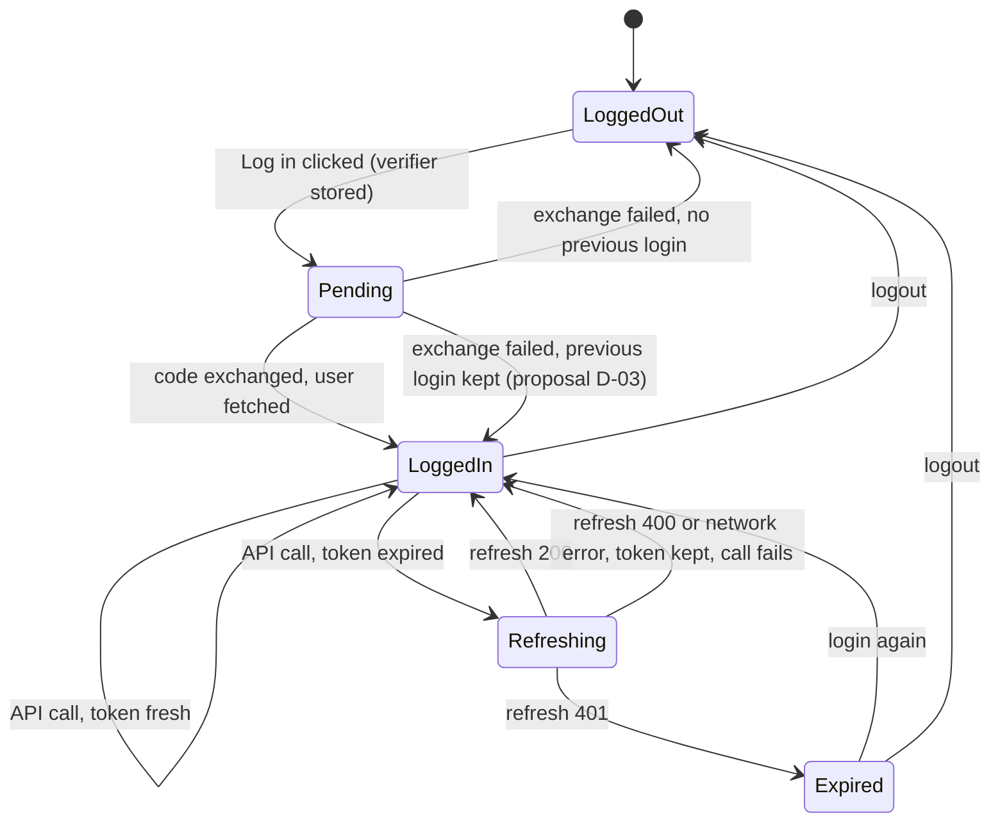
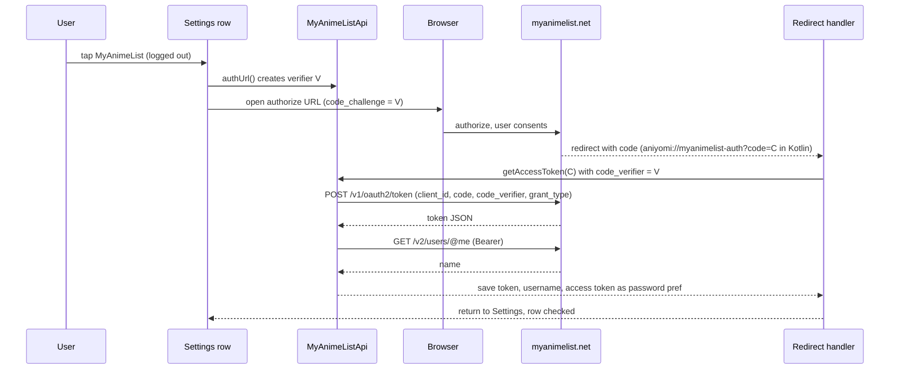
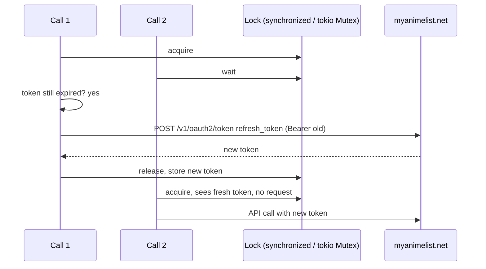

# Topic: MyAnimeList OAuth login, token lifecycle and auth state

Scope files: `app/src/main/java/eu/kanade/tachiyomi/data/track/myanimelist/MyAnimeList.kt`, `MyAnimeListApi.kt`, `MyAnimeListInterceptor.kt`, `dto/MALOAuth.kt`. Helpers: `app/src/main/java/eu/kanade/tachiyomi/util/PkceUtil.kt`, `app/src/main/java/eu/kanade/tachiyomi/ui/setting/track/TrackLoginActivity.kt`. Full detail is in `p1-behavior.md` sections 4 and 13. This file gives the state machine and the sequences in one place.

## 1. States

Two independent facts are stored: "has a token" (the token JSON) and "expired flag" (the auth-expired preference). The UI reads "logged in" from username and password only.



Table of the observable state per combination (from source):

| Token | Expired flag | `isLoggedIn` (UI) | API calls | Source |
|---|---|---|---|---|
| none | false | false | fail `MAL: User is not authenticated` | `MyAnimeListInterceptor.kt:28-30` |
| present, fresh | false | true | succeed | `:24-38` |
| present, expired | false | true | refresh first | `:24-26` |
| present, any | true | true | fail `MAL: Login has expired` before anything | `:19-21` |
| "null" or corrupt | false | depends on username and password | fail as "not authenticated" (`loadOAuth` returns null) | `MyAnimeList.kt:280-286` |

Note the row "present, any, expired flag true". The UI still shows the account as logged in. Kurobayomi shows a warning (proposal, T-29a-047).

## 2. Login sequence



Kurobayomi replaces the redirect handler with a loopback listener on `127.0.0.1:8765` plus a paste field (`p1-rust-design.md` section 3.6). The sequence is otherwise identical.

Failure branches (Kotlin behaviour in brackets):
- Consent denied, no `code`: Kotlin calls `logout()` (clears an existing login). Kurobayomi keeps it (D-04).
- Exchange error: Kotlin swallows and `logout()`. Kurobayomi keeps an existing login and shows the error (D-03).
- `/users/@me` error: same as exchange error.
- Verifier lost (restart): exchange fails. Kurobayomi persists the verifier until consumed (T-29a-038).

## 3. Refresh sequence (single flight)



Rules:
- The lock covers the check and the refresh request, not the API call.
- The refresh request is built by hand with the old Bearer header and does not pass through the Bearer step (`MyAnimeListApi.kt:408-423`). That prevents re-entry.
- The second check under the lock (`MyAnimeListInterceptor.kt:52`) is the double-checked pattern. Kurobayomi keeps it.

## 4. Expiry arithmetic

```
expires_at_seconds = created_at + (expires_in - 60)
expired            = expires_at_seconds < now_seconds        (strict)
```

- `created_at` defaults to parse time when the token endpoint omits it (`MALOAuth.kt:18-19`).
- Stored `created_at` is seconds, not milliseconds.
- Test case: `expires_in = 100`, `created_at = 0`. Not expired at `now = 40`. Expired at `now = 41`.
- Short lifetimes: with `expires_in < 60` the Kotlin margin makes every token expired at once. Kurobayomi clamps the margin (D-19).

## 5. Token storage contract

| Item | Kotlin storage (Android) | Kurobayomi storage |
|---|---|---|
| Token JSON | `__PRIVATE_track_token_1` (string) | Secret Service item, or 0600 fallback file |
| Access token copy | `__PRIVATE_pref_mangasync_password_1` | not stored separately |
| Username | `__PRIVATE_pref_mangasync_username_1` | config TOML `username` |
| Expired flag | `__PRIVATE_pref_tracker_auth_expired_1` | config TOML `auth_expired` |
| Pending verifier | in memory (companion variable) | config TOML `pending_verifier`, removed after use |

Kotlin backups exclude the `__PRIVATE_` keys. Kurobayomi excludes the secret store and the config keys that hold login state from backups (T-29a-046).

## 6. Client id decision

The Kotlin client id `686b980ff4240fccce7f6a654cea07ce` belongs to the Aniyomi project's MAL registration. Kurobayomi does not embed it (T-29a-040). The client id is configuration. Without one, the login is disabled with a clear message. Changing the redirect strategy later (custom scheme versus loopback) requires re-registering the client on MAL. The redirect choice is therefore part of T-29a-039 and T-29a-058.

## 7. Logout

Order in Kotlin (`MyAnimeList.kt:262-266`): clear credentials and expired flag, delete token preference, then `setAuth(null)` which writes `"null"`. Kurobayomi order: cancel any in-flight refresh by taking the lock, delete the secret, clear config keys, and never write the string `"null"` (D-07). Logout sends no request to MAL. The Kotlin does not revoke the token on MAL. Proposal: do not add revocation (MAL revocation endpoint is not documented in source). Note it in the UI as "This does not revoke access on MyAnimeList".

## 8. Test matrix

- Login happy path, denied login, exchange error with and without prior login (fixture server).
- Refresh: 200, 400, 401, network error, concurrent calls, logout during refresh.
- Expiry arithmetic at the boundary, short lifetime clamp, missing `created_at`.
- Storage: no `access_token` in config file, no `"null"` written, fallback file mode 0600.
- Log scrubbing: no token values in `tracing` output during login and refresh.

Full list: `p1-edge-cases-and-tests.md` sections 1.1, 1.2, 2 and 5.
