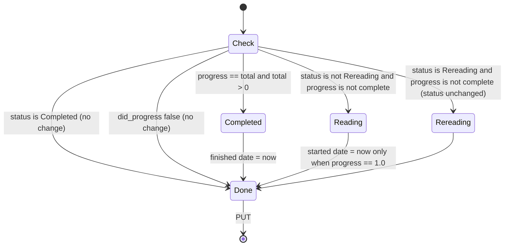
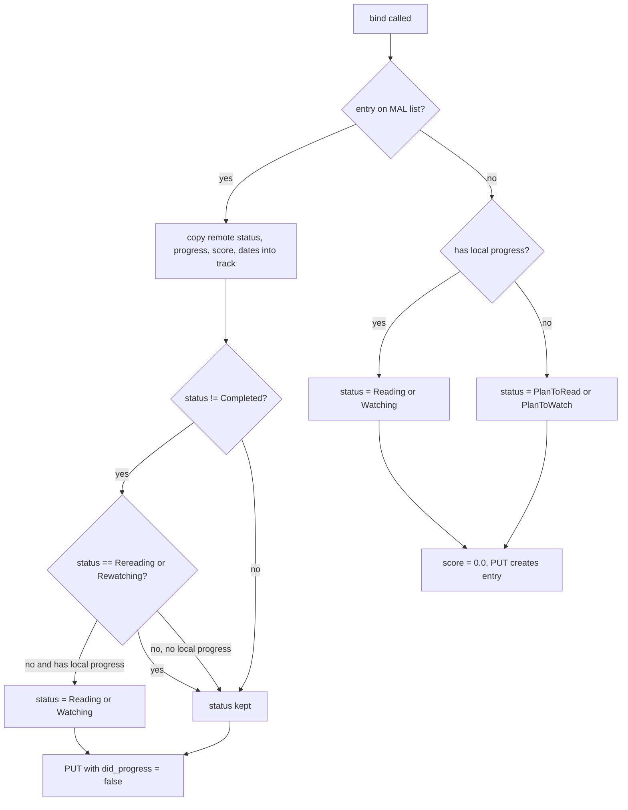

# Topic: MyAnimeList progress sync (status, progress, score, dates)

Scope files: `MyAnimeList.kt` (update, bind, refresh, delete, status tables), `MyAnimeListApi.kt` (list entry fetch, PUT, DELETE, date conversion), `MyAnimeListUtils.kt` (wire mapping), `dto/MALList.kt`. Callers outside scope: `domain/track/manga/interactor/TrackChapter.kt`, `domain/track/anime/interactor/TrackEpisode.kt`, `AddMangaTracks.kt`, `AddAnimeTracks.kt`, `RefreshMangaTracks.kt`, `RefreshAnimeTracks.kt`. Full detail: `p1-behavior.md` sections 1, 2, 3, 5.7, 5.8, 6.

## 1. What is synced

| Local field | Remote field (form on PUT, response on GET) | Rule |
|---|---|---|
| status | `status` (wire string) plus `is_rereading` / `is_rewatching` | section 2 |
| last_chapter_read | `num_chapters_read` (truncated integer) | local value is the truth on PUT |
| last_episode_seen | `num_watched_episodes` on PUT, `num_episodes_watched` on GET | same |
| score | `score` (sent as `"8.0"`, received as integer) | 0 to 10, 0 is unscored |
| started_* | `start_date` (`yyyy-MM-dd`) | local midnight, 0 clears |
| finished_* | `finish_date` | same |
| total_chapters / total_episodes | GET `num_chapters` / `num_episodes` | taken from remote on every `find_list_item` |
| private | not synced | MAL has no private flag |
| library_id | not synced | null for MAL |

## 2. Status transitions

### 2.1 Progress-driven (`update(track, did_progress = true)`)

Manga and anime use the same rules. Anime uses Watching, Rewatching, and the watching dates.

Rules, restated for implementers:
1. Completed is terminal for this function. No progress event changes a Completed title.
2. Completion is checked before the rereading check. A reread that reaches the end becomes Completed.
3. Completion needs a known total (`total > 0`). Unknown totals (0) never complete automatically.
4. Start date is set only at exactly 1.0 progress. Reading chapter 1 again later does not reset it.
5. The finish date is set to the current instant (ms), not to midnight.

### 2.2 Interface setters (`MangaTracker.kt:66-89`, `AnimeTracker.kt:67-88`)

These run before the PUT and do not call `update(..., true)`:

| Setter | Effect before PUT |
|---|---|
| `setRemoteMangaStatus(s)` | status = s; if s == Completed and total > 0, progress = total |
| `setRemoteLastChapterRead(n)` | if progress == 0 and 0 < n and status != Rereading then status = Reading; progress = n; if total > 0 and n == total then status = Completed and finish date = now |
| `setRemoteScore(label)` | score = index of label (or -1, defect D-12) |
| `setRemoteStartDate(ms)` / `setRemoteFinishDate(ms)` | date = ms |
| `setRemotePrivate(b)` | private = b (not sent) |

Note that `setRemoteLastChapterRead` does not run the `update` completion logic, because it calls `update(track)` with `did_progress = false`. The completion is done in the setter itself.

### 2.3 Bind (`bind`, `MyAnimeList.kt:169-207`)

The copy step on the "yes" branch copies the instance onto itself (`findListItem` returns the same track, D-02). The effective behaviour is that the remote values are already in `track`.

### 2.4 Refresh (`refresh`, `MyAnimeList.kt:241-247`)

`find_list_item(track) ?: PUT(track)`. Refresh takes the remote values when the entry exists. When it does not, it recreates the entry from local values. The Kotlin does this silently. Kurobayomi shows a toast (D-10 proposal).

Refresh is called before every progress update in `TrackChapter` and `TrackEpisode`. That means a progress update on a title removed from MAL recreates the title with the local progress.

## 3. Date handling

- Input from MAL: `yyyy-MM-dd` (or partial, see D-08). Parsed in the process time zone to local midnight.
- Output to MAL: local calendar date of the stored instant. 0 becomes `""` (clears the remote date).
- Finish dates set by completion carry the time of day in the local value. The remote date is the local calendar date of that instant.
- Round trip is exact for dates, not for instants: a stored `now` comes back as midnight on the same local date after a refresh.
- Time-zone change: the stored instants stay the same. The displayed dates can shift by one day. The Kotlin has the same behaviour.

## 4. Score

- Local values are `Double` in 0..10. The picker index equals the value.
- Remote values are integers. 0 means unscored and is shown as "0".
- Sent value: `Double.toString` in Kotlin gives `"8.0"`. Kurobayomi default keeps this (D-11). The integer form is a switch pending live verification (T-29a-058).
- Score -1 is a defect path. It is refused in Kurobayomi (D-12).

## 5. Errors and partial failures

- A failed PUT does not change the local row. The caller (`updateRemote`) logs and shows the message. The local row is written only after success (`MangaTracker.kt:112-116`). A partial update is therefore possible only on the remote side.
- A PUT that succeeds but returns a response without dates keeps the local dates (`parseMangaItem` only overwrites non-null values).
- A `find_list_item` that succeeds with an entry and a date that does not parse fails the whole call (D-08). The local row is not updated.
- Delete after a progress update: the PUT upserts, so a deleted-then-updated title reappears on MAL (race 4 in `p1-edge-cases-and-tests.md`, proposal T-29a-056).

## 6. Test matrix

- Table: every row of 2.1 for manga and anime, with `total` of 0, of 12, and progress 12 and 12.5.
- Bind: every branch of the 2.3 flowchart with fixtures `manga_list_entry_present.json` and `manga_list_entry_absent.json`.
- Refresh: found and not found (re-add).
- Dates: round trips, 0 clears, partial dates, DST-gap midnight.
- Score: index mapping, unknown label, wire format default and switch.

Full list: `p1-edge-cases-and-tests.md` section 5 (`status_*`, `score_*`, `date_*`, `update_*`, `bind_*`, `refresh_*`, `form_*`).
