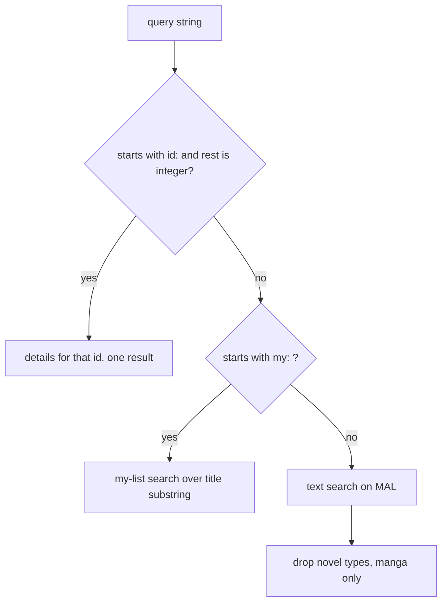

# Topic: MyAnimeList search routing, detail fan-out and "my list" search

Scope files: `MyAnimeList.kt` (routing, `searchManga`, `searchAnime`), `MyAnimeListApi.kt` (`search`, `searchAnime`, `getMangaDetails`, `getAnimeDetails`, `findListItems`, `findListItemsAnime`, `getListPage`), `dto/MALSearch.kt`, `dto/MALUserListSearch.kt`. Full detail: `p1-behavior.md` sections 5.3 to 5.5, 5.10 and 7.

## 1. Routing



- Checked in this order: `id:`, then `my:`, then text. A malformed `id:` falls through to text search.
- `id:` and `my:` are case-sensitive and must be at the start.
- The router is the same for manga and anime except for the endpoint and the novel filter.

## 2. Text search fan-out

Text search is two requests:
1. Search endpoint with `q` (truncated to 64 UTF-16 units) and `nsfw=true`. Returns ids only.
2. One details request per id. All requests start at once with no limit (`MyAnimeListApi.kt:93`, `:113`). The results are collected in the search order (`awaitAll`).

Consequences:
- A search with 100 hits sends 101 requests. This is the main cost of search.
- One failing details request fails the whole search (`awaitAll` rethrows). Kurobayomi keeps the successful hits and shows a count of failures (proposal, E-SEARCH-9).
- Manga search drops items whose `publishing_type` contains `novel` (`MyAnimeListApi.kt:95`). Anime does not.

Proposal (T-29a-037): `buffered(4)` for the detail requests, same order, same failure handling as above.

Open question for T-29a-058: whether the search endpoint accepts the `fields` parameter with the details field list. If it does, the detail requests can be removed. Until verified, keep the two-step flow.

## 3. Duplicate `q` on anime search

`searchAnime` appends `q=<take(64)>` and then `q=<full query>` (`MyAnimeListApi.kt:104-105`). Manga sends one `q`. The second `q` is the untruncated query, so for queries longer than 64 characters the request carries two different values for the same key. The server behaviour is not documented in source. Kurobayomi sends one truncated `q` (D-09). T-29a-058 confirms the result.

## 4. Id lookup

`id:<n>` calls `getMangaDetails(n)` or `getAnimeDetails(n)` and returns one result. There is no novel filter on this path (`MyAnimeList.kt:209-214`). `n` is parsed with `toIntOrNull`, so values above 2^31 - 1 fall through to text search. Negative numbers are sent to MAL and return 404.

## 5. My-list search (manga)

Paging loop over the user's manga list:

```
offset = 0
loop:
    page = GET /v2/users/@me/mangalist?fields=list_status{start_date,finish_date}&limit=250[&offset=offset]
    hits = page.data where node.title contains query (case-insensitive)
    details = for each hit: GET /v2/manga/{node.id}?fields=...   (no limit, Kotlin)
    results += details
    if page.paging.next is not null and not blank: offset += 250, continue
    break
```

- Matching is done on the list title, not on the details title. The two can differ (for example English and romaji).
- The details request does not return the user's list status. Results have status 0, progress 0, and score = mean (defect D-15). The row must not show a status. Kurobayomi offers "Refresh" to fetch the entry status (T-29a-049).
- An empty query matches every entry. The Kotlin then requests details for the whole list. Kurobayomi caps the displayed results at 200 (proposal in `p1-rust-design.md` pitfalls).
- Recursion depth equals the number of pages. Fine for typical lists (250 per page).

## 6. My-list search (anime): the endpoint bug

`findListItemsAnime` calls the same `getListPage`, which always requests `/v2/users/@me/mangalist` (`MyAnimeListApi.kt:323-327`). The titles are then matched and the ids are passed to `getAnimeDetails`.

Observed result:
- If no manga title matches, the result is empty and nothing else is requested.
- If a manga title matches, `getAnimeDetails(mangaId)` runs. Most manga ids are not anime ids, so MAL returns 404 and the whole search fails with `HTTP error 404`.
- If a manga id happens to be an anime id, the wrong anime is returned.

Fix (D-01, T-29a-015): request `/v2/users/@me/animelist` for the anime search, with the same `fields`, `limit` and `offset` rules. Confirm the response shape with T-29a-058 before release. The response item shape is assumed to match the manga list (`node{id,title}`, `paging.next`).

## 7. Paging rules

- Page size 250 (`LIST_PAGINATION_AMOUNT`). The `limit` parameter is sent every time.
- `offset` is sent only when greater than 0. The first page has no offset parameter.
- Next page exists when `paging.next` is not null and not blank (`isNullOrBlank`). The value of `next` is not used; the next offset is computed locally.
- If `paging` is absent from the response, decoding fails (`MALUserSearchResult.paging` is required). Kurobayomi treats an absent `paging` as the last page (proposal, E-SEARCH-16, to verify).

## 8. Result shapes

| Path | Fields filled | Missing |
|---|---|---|
| Text search and id lookup | id, title, summary, total, mean (score), cover_url, tracking_url, publishing_status, publishing_type, start_date | status, progress, dates, private |
| My-list search | same as above | status, progress, dates (no list status requested) |

Authors and artists are empty for MAL in every path.

## 9. Tests

- Routing table: `id:42`, `id:abc`, `id:`, `id:-7`, `my:`, `my:Title`, `Title`, `MY:Title` (case-sensitive, falls to text).
- Query truncation at 64 units with an emoji at the boundary.
- Single `q` for anime (D-09).
- Novel filter: `light_novel` removed, `manga` kept, `Novel` kept (case-sensitive).
- Detail fan-out: concurrency at most 4 (T-29a-037), order preserved.
- My-list paging: two pages of 250 and 1, offsets 0 then 250, `offset` absent on the first request.
- My-list title filter: case-insensitive, empty query matches all.
- Anime my-list after the D-01 fix: request path `/v2/users/@me/animelist`.

Fixtures: `mangalist_page1.json`, `mangalist_page2.json`, `manga_search.json`, `manga_details_1.json`, `manga_details_2.json`, `anime_details_1.json` (see `p1-edge-cases-and-tests.md` section 4).
